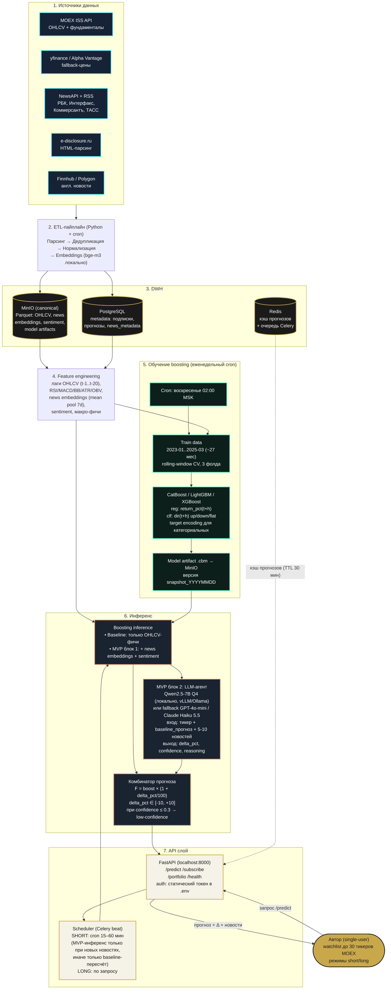

# ML System Design Doc — AInvestor

## Дизайн ML системы — Итерация 1 (MVP)

*Шаблон ML System Design Doc от [Reliable ML](https://t.me/reliable_ml)*

---

| Поле | Значение |
|------|-------|
| **Продукт** | AInvestor — гибридный инвестиционный ассистент |
| **Итерация** | 1 (MVP) |
| **Автор** | Скобей Илья (Data scientist) |
| **Дата** | 2026-10-28 |
| **Версия документа** | 0.1   |

---

## Содержание

1. [Цели и предпосылки](#1-цели-и-предпосылки)
   - [1.1. Зачем идем в разработку продукта?](#11-зачем-идем-в-разработку-продукта)
   - [1.2. Бизнес-требования и ограничения](#12-бизнес-требования-и-ограничения)
   - [1.3. Что входит в скоуп проекта/итерации, что не входит](#13-что-входит-в-скоуп-проектаитерации-что-не-входит)
   - [1.4. Предпосылки решения](#14-предпосылки-решения)
2. [Методология](#2-методология)
   - [2.1. Постановка задачи](#21-постановка-задачи)
   - [2.2. Архитектура решения](#22-архитектура-решения-блок-схема--описание)
   - [2.3. Этапы решения задачи](#23-этапы-решения-задачи)
3. [Подготовка пилота](#3-подготовка-пилота)
4. [Внедрение](#4-внедрение)

---

## 1. Цели и предпосылки

Настоящий дизайн-документ описывает архитектуру и методологию построения ML-системы AInvestor — гибридного инвестиционного ассистента, который объединяет ML-модель прогноза цены акций на основе истории и экономических соображений с корректирующим LLM-агентом, опирающимся на новостной контекст. Решение разрабатывается итеративно: первой итерацией является MVP с прогнозом 1–5 торговых дней на российском рынке (MOEX), с последующим выходом на международный рынок (NYSE/NASDAQ).

### 1.1. Зачем идем в разработку продукта?

#### Бизнес-цель

Создать персональный ML-инструмент для собственного использования — частным инвестором, который хочет систематизировать свой инвестиционный процесс и проверить, может ли гибридная ML-архитектура реально приносить прибыль на российском фондовом рынке (MOEX) с горизонтом 1–5 торговых дней.
Внешняя аудитория на данном этапе отсутствует: продукт разворачивается как single-user система для одного автора-пользователя на собственном ПК с GPU, без онбординга, без публичного доступа и без метрик engagement/retention.
Однако при успешном запуске MVP на следующих этапах рассматривается расширение на внешних пользователей.
Продукт объединяет в одном сервисе три ключевые функции:
(1) автоматический мониторинг рынка и новостного фона по подписанным тикерам,
(2) прогноз цены акций на горизонте 1–5 торговых дней, выполненный на основе количественных признаков стандартной моделью классического ML (в MVP - это градиентный бустинг и далее будет везде описываться он), и
(3) корректирующую LLM-обработку прогноза с учётом свежих новостей по эмитенту, сектору и макро-повестке. Наличие собственного GPU (RTX 5070 12 GB VRAM) позволяет использовать локальную LLM (Qwen2.5-7B) как целевой вариант, без затрат на LLM-API.
Бизнес-цель итерации 1 — получить технически работающий MVP, который демонстрирует добавленную ценность гибридного подхода «boosting + LLM-агент» по сравнению с чистой моделью бустинга, и подготовить базу для live-эксплуатации в режиме бумажной торговли (paper trading) с последующим переходом к реальным сделкам.

#### Почему станет лучше, чем сейчас, от использования ML

Текущая альтернатива — самостоятельный ручной анализ рынка — страдает от трёх системных ограничений, которые ML-решение снимает по отдельности, а гибридная архитектура — комбинированно.
Во-первых, человек физически не способен одновременно отслеживать десятки тикеров, десятки новостных источников (РБК, Интерфакс, Коммерсантъ, ТАСС, e-disclosure, корпоративные пресс-релизы) и сопоставлять их с технической картиной; автоматический пайплайн снимает это ограничение по пропускной способности.
Во-вторых, человеческие решения подвержены эмоциональным искажениям (FOMO, loss aversion, anchoring) — даже при наличии дисциплинированной торговой системы эти эффекты регулярно дают о себе знать; статистическая модель бустинга по определению свободна от этих эффектов и работает воспроизводимо.
В-третьих, классический boosting хорошо улавливает паттерны в OHLCV-данных, но «не видит» контекст: выход отчётности, разводение акций, санкционные новости могут сделать чисто статистический прогноз нерелевантным.
Именно эту третью проблему решает LLM-агент-корректировщик: он читает контекст свежих новостей и либо подтверждает прогноз бустинга, либо корректирует его на Δ% вверх/вниз, либо обесценивает при критических событиях.

#### Что считаем успехом итерации с точки зрения бизнеса
Итерация 1 (MVP) считается успешной при одновременном выполнении следующих бизнес-критериев:
(а) работающий end-to-end пайплайн в docker-контейнере, способный принимать на вход список тикеров и отдавать структурированный прогноз цены + направление + уровень уверенности;
(б) наличие двух режимов работы — short (постоянный мониторинг с интервалом 15–60 минут) и long (разовый запрос пользователя);
(в) воспроизводимые бэктесты за период 2023-01-01..2025-09-30 (~33 месяца), в которых гибридный прогноз MVP статистически значимо превосходит бейзлайн (только boosting) хотя бы по одной из бизнес-метрик — Directional Accuracy или Sharpe простой long-only стратегии;
(г) экономически обоснованная стоимость инференса (на стадии МВП предполагается разворачивать бесплатную модель, в случае ее недостаточной работоспособности предполагается переход на LLM-api, но при условии сохранения суммарных затрат проекта менее $200/мес).
Главный итоговый критерий успеха итерации — положительная экономическая целесообразность live-эксплуатации: кумулятивный PnL простой long-only стратегии на основе MVP-прогноза за период live-тестирования (paper trading, 4 недели, виртуальный капитал 300 000 ₽ — см. раздел 3.2) должен превышать совокупные затраты на инфраструктуру и API за тот же период. Все формализованные метрики и пороги сосредоточены в разделе 3.2 (Single Source of Truth — там же DA, Sharpe, Hit Rate, PnL, uptime, стоимость); из 1.1 делается ссылка, чтобы избежать расхождения порогов.
При невыполнении хотя бы одного условия итерация считается неуспешной и требуется ревизия архитектуры.

### 1.2. Бизнес-требования и ограничения

#### Краткое описание бизнес-требований

Продукт предназначен для персонального использования автором проекта в качестве основного пользователя.
Внешняя аудитория на данном этапе отсутствует: продукт разворачивается как single-user система (1 автор-пользователь), что снимает необходимость онбординга, регистрации внешних пользователей, multi-tenant изоляции и метрик engagement/retention.
В итерации 1 продукт фокусируется на российском рынке — Московской бирже (MOEX) с дневным горизонтом принятия решений; последующие итерации предусмотрят выход на международный рынок (NYSE/NASDAQ) и, при условии успеха предшествующих итераций, открытие продукта для внешней аудитории.
Подробный перечень БТ фиксируется непосредственно в настоящем дизайн-документе и репозитории проекта (git), отдельная внешняя система требований в первой итерации не используется.
Ключевые БТ: AINV-001 — поддержка как минимум 30 наиболее ликвидных тикеров MOEX (SBER, GAZP, LKOH, YNDX, ROSN, GMKN, MTSS и др.);
AINV-002 — возможность подписки пользователя на произвольный набор тикеров (до 30 на одного пользователя в пилоте, согласовано с AINV-001 — universe зафиксирован на 30 тикерах);
AINV-003 — предоставление прогноза цены на горизонтах 1, 2, 3 и 5 торговых дней;
AINV-004 — объяснимость: каждый прогноз должен содержать указание, какие новости повлияли на корректирующую Δ;
AINV-005 — два режима работы: short (постоянный мониторинг) и long (по запросу);
AINV-006 — REST API для собственного использования (в перспективе — для мобильного клиента).

#### Бизнес-ограничения

- Бюджет итерации 1 — не более `$200/мес` совокупных затрат на инфраструктуру и внешние API (LLM, новостные источники) при разворачивании на VPS. При разворачивании на собственном ПК автора (16 vCPU / 16 GB RAM / 200 GB SSD / RTX 5070 12 GB VRAM) целевые операционные затраты — **`$0/мес`** (только опциональные premium-источники данных, например Alpha Vantage $50/мес). Fallback на VPS — при нехватке собственных мощностей или необходимости 24/7 availability. Это ограничение напрямую влияет на выбор LLM (локальная на своей GPU vs облачная по API) и на количество тикеров.
- Время на разработку итерации 1 — 8 недель (2 спринта по 4 недели) силами 1 ML-инженера (совмещённая роль DS/ML Ops/Product Owner).
- Latency-ограничения: для short-режима обновление прогноза по одному тикеру не должно превышать 5 минут от момента получения новой цены/новости; для long-режима — не более 5 минут от запроса пользователя до ответа.
- Законодательные ограничения: обработка персональных данных пользователей (email, подписки, история прогнозов) подчиняется 152-ФЗ «О персональных данных»; рыночные данные MOEX используются в соответствии с условиями MOEX ISS API (некоммерческое использование в рамках пилота).
- Регуляторные ограничения: сервис не исполняет сделки автоматически, не является инвестиционной рекомендацией в смысле 39-ФЗ «О рынке ценных бумаг», и должен содержать дисклеймер «не является индивидуальной инвестиционной рекомендацией» во всех пользовательских интерфейсах.
- Зависимость от внешних провайдеров: LLM-API (OpenAI/Anthropic) может быть недоступен из РФ; primary-стратегия — локальная модель Qwen2.5-7B через Ollama/vLLM на собственном GPU (RTX 5070 12 GB VRAM), fallback-стратегия — использование более слабых моделей-альтернатив (Deepseek) или переход на LLM-API при недоступности собственных мощностей.

#### Что мы ожидаем от конкретной итерации

От итерации 1 ожидается: работающий docker-compose стек, разворачиваемый одной командой на собственном ПК автора (16 vCPU / 16 GB RAM / 200 GB SSD / RTX 5070 12 GB VRAM) с перспективой миграции на VPS при необходимости 24/7 availability; end-to-end пайплайн от сбора данных до выдачи прогноза через REST API; бэктест за период 2023-01-01..2025-09-30 (~33 месяца) по 30 тикерам MOEX с разбивкой на baseline и MVP-режимы; технический отчёт с метриками качества и оценкой экономической целесообразности production-запуска. В итерацию **не входит**: разработка мобильного приложения (используются API-вызовы), реальная торговая интеграция с брокерами (T-Investments API, Alor Open API), автоматическое масштабирование под высокую нагрузку, полноценный MLOps-пайплайн ретрейна.

#### Описание бизнес-процесса пилота

В существующем личном инвестиционном процессе автора добавляется следующая точка контакта с продуктом: \
(1) автор локально авторизуется в системе через токен;\
(2) формирует watchlist из тикеров MOEX (до 30 штук);\
(3) выбирает режим — short (постоянный мониторинг с интервалом) или long (запрос по кнопке);\
(4) в short-режиме получает push/email уведомление при существенной коррекции прогноза (|Δ| > 2%);\
(5) в long-режиме нажимает «Получить прогноз» и видит карточку прогноза по каждому тикеру с указанием baseline-цены, MVP-цены (после коррекции), величины Δ, перечня повлиявших новостей с краткой аннотацией от LLM-агента, и дисклеймера.

Модель вписывается в существующий процесс принятия инвестиционного решения как вспомогательный источник информации, а не как автоматический исполнитель сделок. Live-эксплуатация MVP начинается с paper trading (фиксация виртуальных сделок на основе прогнозов), при положительном PnL за период тестирования — постепенный переход к реальным сделкам вручную через интерфейс брокера.

#### Что считаем успешным пилотом? Критерии успеха и возможные пути развития проекта

Пилот длительностью 4 недели после завершения итерации 1 (в режиме paper trading) считается успешным при достижении следующих метрик:

(1) кумулятивный PnL long-only стратегии на основе MVP-прогноза за период пилота превышает совокупные затраты на инфраструктуру и API за тот же период (то есть стратегия самоокупается);\
(2) положительная оценка MVP-прогноза по Directional Accuracy на пилотных данных. Directional Accuracy (MVP) на тестовом окне данных должна статистически значимо превосходить baseline (paired bootstrap, p < 0.05). Конкретные целевые пороги DA/Sharpe фиксируются по результатам EDA на baseline-модели;\
(3) отсутствие критических инцидентов с временной недоступностью сервиса > 5% времени.

Метрики engagement/retention/активности пользователей в данной итерации не применяются: продукт single-user, внешней аудитории нет, и эти метрики не имеют смысла.

Возможные пути развития после успешного пилота: переход от paper trading к реальным сделкам; расширение universe (количества тикеров) до топ-100 MOEX; выход на международный рынок (американские тикеры через yfinance / Alpha Vantage); интеграция с T-Investments и Alor Open API для подачи реальных заявок; разработка мобильного приложения; добавление longer-horizon прогнозов (10–30 дней); открытие продукта для ограниченной внешней аудитории. При неуспешном пилоте возможна ревизия архитектуры — замена LLM на более лёгкую модель, сужение universe или пауза проекта.

### 1.3. Что входит в скоуп проекта/итерации, что не входит

#### На закрытие каких БТ подписываемся в данной итерации

- **AINV-001**: поддержка топ-30 ликвидных тикеров MOEX (список явно зафиксирован в конфиге `universe.yaml`).
- **AINV-002**: возможность подписки пользователя на тикеры, хранение watchlist в PostgreSQL.
- **AINV-003**: выдача прогноза цены `close(t+h)` для `h ∈ {1, 2, 3, 5}` торговых дней.
- **AINV-004**: структура прогноза включает baseline-прогноз boosting, MVP-прогноз после коррекции, значение Δ, и top-3 новости, повлиявшие на коррекцию.
- **AINV-005**: реализация short-режима (cron 15–60 мин, настраивается) и long-режима (по запросу через `POST /predict`).
- **AINV-006**: REST API на FastAPI с эндпоинтами `/predict`, `/subscribe`, `/portfolio`, `/health`. Авторизация упрощённая — один статический токен в `.env` (`AUTH_TOKEN=...`), передаётся в `Authorization: Bearer <token>`. Полноценная JWT-авторизация и регистрация внешних пользователей — задача итерации 2 (см. раздел 4.7).

#### Что не будет закрыто

- Полноценная JWT-авторизация и регистрация внешних пользователей — в итерации 1 используется упрощённая авторизация одним статическим токеном (см. AINV-006 и раздел 4.7). JWT + bcrypt + multi-user — задача итерации 2.
- Мобильное приложение и веб-фронтенд — итерация ограничивается REST API и Postman-коллекцией для тестирования. Веб-интерфейс планируется в итерации 2.
- Интеграция с реальными брокерскими API (T-Investments API, Alor Open API) для автоматической подачи заявок. Только рекомендательная функция, без автоматического исполнения.
- Автоматическое масштабирование под высокую нагрузку (Kubernetes Horizontal Pod Autoscaler). Итерация 1 работает на одном VPS; горизонтальное масштабирование заложено как технический долг.
- Полноценный MLOps-пайплайн: автодетекшен data drift, ретрейн по расписанию, A/B-инфраструктура, shadow-деплой. Ретрейн ручной, по триггеру Data Scientist.
- Поддержка американского рынка в production-режиме. Архитектурно заложена (параметр `region` в конфиге), но в итерации 1 включён только RU-режим.
- Real-time intraday-прогнозы (минутные бары). Горизонт ограничен дневным прогнозом на 1–5 торговых дней.

#### Описание результата с точки зрения качества кода и воспроизводимости решения

Кодовая база отдаётся как монорепозиторий с тремя основными пакетами: `ainvestor-etl` (сбор и обработка данных), `ainvestor-ml` (модели и feature engineering), `ainvestor-api` (FastAPI-сервис).

Все компоненты покрыты unit-тестами (pytest, min coverage 60%).
Воспроизводимость бэктестов обеспечивается фиксацией random seed, версионированием датасетов через snapshot-даты в MinIO (формат `snapshot_YYYYMMDD`; DVC опционально рассматривается в итерации 2), и фиксацией версий библиотек в `pyproject.toml` и `uv.lock`.

Docker-compose стек обеспечивает идентичность окружения разработки и production-подобного VPS. Бэктесты запускаются одной командой и сохраняют результаты в MinIO (S3-совместимое хранилище) с метаданными git-commit + timestamp.

#### Описание планируемого технического долга

- Ручной ретрейн: модель boosting переобучается вручную по триггеру Data Scientist; в итерации 2 планируется Airflow DAG с автодетекшеном data drift.
- Отсутствие A/B-инфраструктуры: сравнение baseline vs MVP проводится на одном временном окне, без одновременного обслуживания трафика двумя версиями.
- Ограниченный universe: 30 тикеров — этого достаточно для пилота, но не покрывает длинный хвост; в production потребуется управление universe-ом.
- Отсутствие feature store: фичи пересчитываются на кадый инференс, feature store (Feast) — задача итерации 2.
- Нет мониторинга качества модели в продакшене; планируется интеграция с Evidently AI в итерации 2.
- Источники данных: API Альфа-Инвестиции, Т-Инвестиции и им подобных не интегрированы (требуют брокерского счёта и сложной авторизации); заложен fallback на MOEX ISS + yfinance.

### 1.4. Предпосылки решения

Предпосылки решения вытекают из бизнес-целей итерации (раздел 1.1) и фиксируются до начала EDA как верхнеуровневые архитектурные и методологические решения. Все предпосылки обоснованы запросом бизнеса и могут быть пересмотрены по результатам EDA.

#### Горизонт прогноза

Горизонт прогноза фиксирован как `h ∈ {1, 2, 3, 5}` торговых дней. Выбор обусловлен пользовательским сценарием: дневной инвестор принимает решение «купить/держать/продать» на горизонте ближайшей недели, более короткие (intraday) и более длинные (10–30 дней) горизонты не соответствуют продуктовому позиционированию. Для каждого `h` обучается отдельная модель boosting (multi-target рассматривается в качестве отдельного вопроса на EDA, но судя по другим проектам, кажется, что этот подход был бы менее точным).

#### Гранулярность модели

Гранулярность — дневные OHLCV-бары (open, high, low, close, volume) по торговым дням MOEX. Внутридневные данные (минутные, часовые бары) не используются в итерации 1, так как они требуют существенно более сложной инфраструктуры (streaming, low-latency pipeline) и не соответствуют MVP-горизонту. Частота пересчёта прогнозных моделей — daily для boosting (обучение раз в неделю по cron), для LLM-агента — на каждый инференс (каждый short-tick или long-запрос), поскольку новостной контекст меняется непрерывно.

#### Блоки данных, используемые в системе

- **Ценовые данные (OHLCV daily)** — основная сущность, на которой обучается boosting-модель; источник — MOEX ISS API (primary), yfinance / Alpha Vantage (fallback, в т.ч. для ADR-тикеров).
- **Фундаментальные данные (P/E, P/B, EPS, дивидендная доходность, выручка, чистая прибыль)** — источник MOEX ISS + Alpha Vantage. SEC EDGAR исключён: после делистинга ADR российских эмитентов (Yandex NV → Nebius/YDEV, выплата инвесторам завершена) актуальных 10-K/10-Q по тикерам из топ-30 MOEX на SEC фактически нет. Может быть возвращён в итерации 2 при выходе на US-рынок.
- **Новостной контент (статьи, заголовки, даты, источники)** — источник NewsAPI + RSS-фиды РБК / Интерфакс / Коммерсантъ / ТАСС / e-disclosure.ru + Finnhub / Polygon. Canonical store для embeddings — MinIO (см. раздел 2.2), PostgreSQL хранит только метаданные (заголовок, дата, тикер, minio_path).
- **Сентимент-оценки** — Finnhub sentiment API + собственный LLM-вычисленный сентимент по каждой статье .
- **Макро-показатели (ключевая ставка ЦБ РФ, курс USD/RUB, цены на нефть Brent)** — источник CBR API + MOEX; используются как дополнительные фичи в boosting.

#### Архитектурные предпосылки

- Контейнеризация: все компоненты упакованы в docker-контейнеры, оркестрация через docker-compose (на перспективу — Kubernetes).
- Сервисная архитектура: FastAPI (API + бизнес-логика) + Celery worker (асинхронные задачи ETL и инференс) + PostgreSQL (пользователи, подписки, история прогнозов) + Redis (кэш, очередь задач) + MinIO (S3-совместимое хранилище датасетов и моделей).
- LLM-шлюз: единый абстрактный слой для вызова LLM, поддерживающий провайдеров OpenAI, Anthropic, локальный Ollama/vLLM; выбор провайдера — через переменную окружения.
- Два режима работы: **SHORT** (cron-based, 15–60 мин, обрабатывает все тикеры всех пользователей, в MVP - все тикеры одного пользователя) и **LONG** (по запросу, через `POST /predict` для одного тикера).
- Хостинг: **primary** — собственный ПК автора (16 vCPU / 16 GB RAM / 200 GB SSD / RTX 5070 12 GB VRAM), зона РФ для доступа к MOEX API; **fallback** — арендуемый VPS (8 vCPU / 16 GB RAM / 200 GB SSD, $40–80/мес) при необходимости 24/7 availability или при нехватке собственных мощностей. GPU на собственном ПК позволяет запускать локальную LLM (Qwen2.5-7B через vLLM/Ollama) как primary-вариант.

---

## 2. Методология

### 2.1. Постановка задачи

С технической точки зрения задача формулируется как гибрид регрессии и классификации с последующей LLM-коррекцией. Формальная постановка: по истории OHLCV-баров `{X_{t-N}, ..., X_t}` тикера `i` и набору новостных статей `{N_{t-M}, ..., N_t}` по тикеру `i` требуется предсказать цену закрытия `close(t+h)` и направление движения `D(t+h) ∈ {up, down, flat}`, где `h ∈ {1, 2, 3, 5}` торговых дней.

#### Бейзлайн

Бейзлайн решает задачу только на основе OHLCV-фичей (без новостей). Используется модель градиентного бустинга (CatBoost / LightGBM / XGBoost — выбор фиксируется на этапе 2.3 по результатам EDA). Целевая переменная — `close(t+h)` (регрессия) и `sign(close(t+h) - close(t))` (трёхклассовая классификация up/down/flat с порогом 0.5%). Фичи — лаговые OHLCV (`t-1..t-20`), технические индикаторы (RSI_14, MACD, Bollinger Bands, ATR, OBV), календарные признаки (`day_of_week`, `month`, `is_month_end`). Обучение — отдельно для каждого горизонта `h`, на окне `t-2y..t-1m` (rolling window).

#### MVP

MVP добавляет к бейзлайну второй блок — LLM-агента-корректировщика. Блок 1 (boosting) остаётся тем же стеком, но обучается на расширенном наборе фичей: к лаговым OHLCV добавляются news embeddings (усреднённые эмбеддинги статей за последние 7 дней, полученные через лёгкую embedding-модель, например, `text-embedding-3-small` или локально, например, `bge-m3`) и aggregated sentiment score `∈ [-1, +1]`.
Блок 2 (LLM-агент) получает на вход промпт, содержащий: тикер, целевую дату прогноза, baseline-прогноз цены boosting-модели, и список из 5–10 (возможна корректировка в процессе реализации) свежих новостей по тикеру за последние 7 дней с заголовками и краткой аннотацией. LLM возвращает структурированный ответ: `{delta_pct: float, confidence: float, reasoning: str, key_news_ids: [int]}`. Финальный прогноз цены:

> **`F(t+h) = boost(t+h) × (1 + delta_pct / 100)`**, где `delta_pct ∈ [-10, +10]`

#### Сценарии коррекции

- **Подтверждение**: `|delta_pct| < 0.5%` - LLM соглашается с прогнозом boosting, финальный прогноз ≈ baseline.
- **Умеренная коррекция**: `0.5% ≤ |delta_pct| < 3%` - LLM вносит поправку на новостной контекст (например, выходит отчётность лучше консенсуса).
- **Сильная коррекция**: `3% ≤ |delta_pct| < 10%` - существенное новостное событие (например, неожиданная смена CEO, крупная сделка M&A).
- **Обесценивание**: `|delta_pct| = ±10%` - граница диапазона с пометкой `confidence ≤ 0.3` — критическое событие (санкции, делистинг, форс-мажор); прогноз помечается как низко-надёжный.

Кандидаты на роль LLM-агента (по итогам EDA): целевой вариант — локальная модель **Qwen2.5-7B-Instruct в Q4-квантовании** (Q4_K_M, ~4.4–5.5 GB VRAM) через vLLM/Ollama на собственном GPU RTX 5070 12 GB VRAM. **Важно про VRAM**: Qwen2.5-7B в BF16 требует ~14.4 GB VRAM — в 12 GB не влезает; Q4 (4.4–5.5 GB) или FP8 (~7 GB) — обязательны. С этим же GPU одновременно работает embedding-модель bge-m3 (~2.3 GB), vLLM KV-cache и десктопные задачи пользователя, поэтому памяти получается почти целиком затраченна; в vLLM необходимо явно зафиксировать `gpu_memory_utilization=0.7` и очерёдность по GPU (LLM-инференс > embeddings, embeddings могут кэшироваться в CPU). При нехватке VRAM — fallback на Qwen2.5-3B Q4 (~2 GB) или Phi-3-mini (~2 GB). Или же уход на VPS с большими ресурсами/llm-api.

Latency: на RTX 5070 Qwen2.5-7B Q4 выдаёт ~75–90 tok/s; prefill 2k токенов — порядка секунды, генерация 200 токенов — ~2–3 с. \
**Итого ~3–5 с/запрос**. Это целевой вариант, без затрат на API, полностью соответствует бюджету $0/мес.

Если локальные модели покажут недостаточное качество — fallback на gpt-4o-mini, claude haiku 5.5 (требуют LLM-API, платно, см. расчёт стоимости в разделе 2.3 этап 3). Стек boosting-модели (CatBoost / LightGBM / XGBoost) также фиксируется на этапе EDA; предпочтение отдаётся CatBoost благодаря встроенной поддержке категориальных признаков (тикер, сектор) — для 30 тикеров рекомендуется target encoding / leave-one-out вместо one-hot, чтобы избежать проклятия размерности.

### 2.2. Архитектура решения

Ниже представлена блок-схема решения AInvestor в формате Mermaid (рендерится в GitHub/VS Code/Obsidian/Notion) и её текстовое описание. Архитектура явно разделяет:
- **поток обучения** boosting-модели (еженедельный cron → train → артефакт в MinIO),
- **поток инференса** с двумя ветками: **baseline** (только boosting на OHLCV-фичах) и **MVP** (двухблочная архитектура boosting + LLM-агент с последующим комбинатором).

Это разделение позволяет одновременно оценивать обе модели на одних и тех же тестовых данных и количественно измерять добавленную ценность LLM-коррекции.



**Пояснения к потокам на схеме:**

- **Поток обучения** (блок 5, выделен зелёным): cron-еженедельно запускает обучение boosting на train-данных (окно 27 месяцев), модель-артефакт сохраняется в MinIO с версией `snapshot_YYYYMMDD`. Этот поток独立 от инференса и работает офлайн.
- **Поток инференса** (блок 6, выделен оранжевым): на каждый запрос (short-tick или long-запрос) boosting inference берёт свежие фичи + последний артефакт модели из MinIO и выдаёт baseline-прогноз. В MVP дополнительно вызывается LLM-агент с baseline-прогнозом и новостным контекстом → возвращает `delta_pct` → комбинатор считает финальный `F = boost × (1 + delta_pct/100)`.
- **Baseline vs MVP**: блок-схема явно показывает, что baseline использует только верхнюю ветку (Boosting inference → напрямую в API), а MVP добавляет нижнюю ветку (LLM-агент → Комбинатор). Это позволяет на одних и тех же тестовых данных сравнивать обе модели.

**Ключевые блоки решения и связи между ними (текстовое описание):**

- **Источники данных.** Используется пять категорий источников: MOEX ISS API для официальных OHLCV-данных и фундаменталов по тикерам MOEX; yfinance / Alpha Vantage для fallback-цен (yfinance — неофициальный доступ к Yahoo, без SLA, регулярные поломки/throttling — качество частичное); NewsAPI + RSS-фиды для новостного контента из русскоязычных источников (РБК, Интерфакс, Коммерсантъ, ТАСС; e-disclosure.ru — веб-портал корпоративных раскрытий, требует HTML-парсинга); Finnhub / Polygon для англоязычного новостного потока и insider trades (Finnhub free tier — non-commercial only). SEC EDGAR исключён в итерации 1 (после делистинга ADR российских эмитентов актуальных 10-K/10-Q по топ-30 MOEX нет).
- **ETL-пайплайн.** Реализован на Python, оркестрируется через cron на итерации 1 (Airflow заложен как технический долг для итерации 2). ETL выполняет парсинг API/RSS, дедупликацию статей по URL+timestamp, нормализацию текста (lowercase, удаление HTML, токенизация), и сохранение в DWH. Для новостей дополнительно вычисляются embeddings (`bge-m3` локально или `text-embedding-3-small` через OpenAI).
- **DWH.** **Canonical store для аналитических данных — MinIO** (Parquet-файлы: OHLCV-датафреймы, news embeddings, sentiment). PostgreSQL хранит только структурированные метаданные (пользователи, подписки, история прогнозов, метаданные новостей — без тяжёлых embeddings). Дублирование устранено: источник правды по news embeddings = MinIO, PostgreSQL ссылается на путь в MinIO через `news_id` → `minio_path`. Redis — кэш свежих прогнозов (TTL 30 мин) и очередь задач Celery.
- **Feature engineering.** Расчёт фичей выполняется на лету при инференсе для свежих данных и кэшируется в Redis на 24 часа. Лаговые OHLCV (`t-1..t-20`), технические индикаторы (TA-Lib или pandas-ta: `RSI_14`, `MACD`, `Bollinger Bands 20/2`, `ATR_14`, `OBV`), календарные признаки, агрегированные news embeddings (mean pooling за 7 дней), sentiment score `(-1..+1)`.
- **Бейзлайн (Baseline).** Один блок — градиентный бустинг на OHLCV-фичах. Возвращает `close(t+h)` для `h ∈ {1, 2, 3, 5}`. Обучается раз в неделю по cron, артефакт модели сохраняется в MinIO с версионированием.
- **MVP — Блок 1: Boosting.** Тот же стек boosting, но обучение на расширенном наборе фичей (включая news embeddings и sentiment). Это позволяет изолировать эффект LLM-коррекции от расширения feature-набора.
- **MVP — Блок 2: LLM-агент.** Системный промпт: «You are a financial analyst. Given the boosting-model price forecast and the recent news, output a structured JSON correction.» Пользовательский промпт: тикер, целевая дата, baseline-прогноз, 5–10 свежих новостей (заголовок + краткое summary). Вывод — JSON с полями `delta_pct`, `confidence`, `reasoning`, `key_news_ids`.
- **Комбинатор прогноза.** `F(t+h) = boost(t+h) × (1 + delta_pct / 100)`, где `delta_pct` ограничен диапазоном `[-10, +10]`. При `confidence ≤ 0.3` прогноз помечается как low-confidence и пользовательский интерфейс показывает предупреждение.
- **Evaluation framework.** Единый для baseline и MVP, позволяет напрямую сравнивать. Метрики — RMSE/MAE на цене, Directional Accuracy, Sharpe/IR простой long-only стратегии, Hit Rate top-N по expected return, Δ улучшение относительно бейзлайна.
- **FastAPI сервис и Scheduler.** REST API с эндпоинтами `/predict`, `/subscribe`, `/portfolio`, `/health`. Scheduler поддерживает 2 режима: SHORT (cron 15–60 мин, обрабатывает все watchlist-подписки) и LONG (по запросу пользователя).
- **Инфраструктура (Docker Compose).** Контейнеры: `ainvestor-api` (FastAPI + uvicorn), `ainvestor-worker` (Celery), `ainvestor-scheduler` (Celery beat), `postgres`, `redis`, `minio`, `ainvestor-llm-gw` (опционально, для локальной LLM — vLLM/Ollama).

### 2.3. Этапы решения задачи

Ниже описаны 6 этапов решения с разбивкой baseline vs MVP, насколько это применимо. Этапы 1 (подготовка данных) и 5 (инференс) полностью общие для baseline и MVP; этапы 2–4 разделены на baseline и MVP-ветки, поскольку архитектура модели и feature engineering существенно отличаются.

#### Этап 1 — Подготовка данных

> **Опорный EDA**: Выполнен разведочный анализ данных по 15 тикерам MOEX (топ по ликвидности IMOEX) за период 2023-01-03..2025-11-13 (~746 торговых дней). Полный отчёт — `../reports/eda/EDA_report.md`; визуализации — `../reports`; скрипты — `../eda`, `../eda`; агрегаты — `../data`. Выводы EDA напрямую формируют риски и метрики ниже.

##### 1.1. Описание данных и сущностей

**Состав данных** — 5 категорий сущностей, используемых в системе (детализация по таблице 1 в конце раздела):

| Сущность | Источник | Гранулярность | Объём за период EDA | Качество |
|---|---|---|---|---|
| OHLCV daily (price) | MOEX ISS API, board TQBR | 1 строка/тикер/торговый день | 15 тикеров × ~731 день = 10 582 строки; после dropna по close = 10 240 строк | полное, без дублей, но без price-adjustment. |
| Фундаменталы (P/E, P/B, EPS, выручка, чистая прибыль, див. доходность) | MOEX ISS + Alpha Vantage | Квартальная (4 отчёта/год/эмитент) | ~15 тикеров × ~12 кварталов = ~180 наблюдений; после forward-fill на daily-уровень ~10 240 строк × 6 показателей | проверяется на этапе 1.5.|
| Новостной контент (заголовок, текст, дата, тикер) | NewsAPI + RSS (РБК/Интерфакс/Коммерсантъ/ТАСС) + e-disclosure.ru (HTML-парсинг) + Finnhub/Polygon | ~3–20 статей/тикер/день | оценочно ~50 000–150 000 статей за 33 мес | дубликаты, нерелевантность, задержки.|
| Sentiment (LLM-computed) | Локальная Qwen2.5-7B на этапе 2 | 1 строка/статья | ~50 000–150 000 строк | вычисляется на этапе 2.|
| Макро (ключевая ставка ЦБ РФ, USD/RUB, Brent) | CBR API + MOEX | Daily | ~750 строк × 3 показателя | Ок.|

**Формат хранения**: Parquet в MinIO (canonical store), разбивка по сущностям (`ohlcv_daily.parquet`, `news_daily.parquet`, `fundamentals_quarterly.parquet`, `macro_daily.parquet`). Метаданные без embeddings дублируются в PostgreSQL для быстрых lookup-запросов API. Версионирование — через `snapshot_YYYYMMDD` в MinIO.

##### 1.2. Выявленные проблемы с объёмом, качеством и разметкой (риски из EDA)

В результате EDA (`../reports/eda/EDA_report.md`) выявлены 7 категорий проблем:

1. **Корпоративные действия не корректируются MOEX ISS** — детектировано 3 события (см. `../data/processed/corporate_actions.csv`):
   - **GMKN 2024-04-08**: -99% за день (split 100:1, цена упала с ~15 296 ₽ до 153 ₽).
   - **PLZL 2025-03-27**: -90% за день (split 10:1, цена упала с ~18 676 ₽ до 1 868 ₽).
   - **VTBR 2024-07-15**: +466 200% (консолидация 1000:1 + переходный период с NaN-строками 2024-07-09..12).
     MOEX ISS отдаёт raw historical prices без adjustment (в отличие от yfinance, который отдаёт adjusted). **Решение ETL**: шаг `adjust_corporate_actions` — для каждого тикера детектировать места с |pct_change| > 50% между соседними торговыми днями, после чего forward-adjust все цены (open/high/low/close) до события на `ratio = close_after / close_before`. Реализовано в `../eda/02_eda_analysis.py` секция 3; на adjusted данных annualized volatility вернулась к реалистичным 30.7% (было 14401% из-за fake-returns на интерполяции).

2. **YDEX — укороченная история**: только 348 строк с 2024-07-08 (после редомициляции Yandex NV → YDEX). До июля 2024 ценовой истории по Yandex на MOEX нет. **Решение**: либо исключить YDEX из watchlist на первых итерациях, либо обучать только на данных с 2024-07 (16 мес — минимально достаточно для boosting-бейзлайна, но не для лагов 20+).

3. **Высокая cross-ticker корреляция** (средняя 0.538, медиана 0.545; максимум SBER↔YDEX = 0.795; минимум MTSS↔PLZL = 0.273) — типично для MOEX, где ~40% оборота — Сбер + Газпром + нефтегаз. Это **ограничивает ценность purely price-based фичей**: boosting без фундаменталов/новостей вырождается в market-index predictor. **Решение**: обязательное включение фундаментальных фичей (P/E, див. доходность) и новостного сигнала (LLM-агент) — это структурная мотивация двухблочной архитектуры MVP.

4. **Тяжёлые хвосты распределения доходностей**: эксцесс 6.45 (vs. 0 у нормального), skew 0.26, min -22.1%, max +14.0%, std 1.93%/день. **Решение**: Huber loss в LightGBM/CatBoost (а не MSE) + winsorization целевой на ±3σ (~±6%); clip lagged features на ±10%.

5. **Class imbalance** в целевой переменной `dir_1d`: up 34.5% / flat 29.7% / down 35.8% — down-класс слегка преобладает на горизонте 2023-2025 (бычий рынок MOEX, но с двумя коррекциями). **Решение**: stratified walk-forward CV; class weights в CatBoost через `class_weights=[1.0, 1.04]` для компенсации.

6. **Доли flat-дней варьируют 21–39%** по тикерам (YDEX 21%, SBER 39%) — подтверждает решение диздока: основная метрика DA считается на up/down (без flat), DA_3class — secondary. Порог flat ±0.5% отсекает лишь ~30% дней; остальные 70% размечены как up/down.

7. **NaN-строки в переходные дни корпоративных действий**: 23 строки (4 у VTBR 2024-07-09..12, 3 у PLZL, 4 у GMKN, 12 у YDEX в первые недели) с NaN close и нулевым объёмом — дни, когда тикер номинально торгуется, но сделок нет. **Решение**: `dropna(subset=['close'])` перед расчётом returns.

##### 1.3. Процесс генерации данных

**Пайплайн сбора данных (ежедневный + исторический backfill)**:

1. **Исторический backfill (разовый)** — реализован в `../eda/01_fetch_moex_ohlcv.py`:
   - Запрос к `https://iss.moex.com/iss/history/engines/stock/markets/shares/boards/TQBR/securities/<SECID>.json?from=<START>&till=<END>&start=<N>` с пагинацией по 100 строк на запрос.
   - Throttle 0.4 с между запросами (вежливость к API MOEX — лимитов нет, но практика хорошая).
   - Без авторизации, без API key. Сохранение в `../data` + `../data/raw/ohlcv_all.csv` (combined long).

2. **Регулярный incremental update (cron, nightly 02:00 MSK)**:
   - Для каждого тикера из `universe.yaml` — fetch только новых строк с даты последней записи в MinIO.
   - Запись в MinIO `ohlcv_daily.parquet` (новая версия `snapshot_YYYYMMDD`).
   - Новости собираются через NewsAPI + RSS-парсеры ежечасно в течение торговой сессии MOEX (10:00–18:45 MSK).

3. **Фундаменталы (квартально, по выходу отчётности эмитента)**:
   - MOEX ISS endpoint `securities/<SECID>/fundamentals` (quarterly).
   - Alpha Vantage `OVERVIEW` + `INCOME_STATEMENT` — fallback.
   - Парсинг → forward-fill на daily-уровень: один квартал покрывает ~60 торговых дней до следующего отчёта (фичи обновляются 4 раза в год, не каждый день).

4. **Макро-данные (ежедневно)**:
   - CBR API `https://www.cbr.ru/daily_json` — ключевая ставка, USD/RUB.
   - MOEX для Brent (тикер `BZ` на CBR или `ICE.BR` на MOEX).

**Регулярность**: daily OHLCV + макро, hourly news, quarterly fundamentals. Все источники публичные; в среднем latency запроса: MOEX ISS ~0.2–0.5 с, NewsAPI 1–3 с, e-disclosure.ru — высокая (HTML-парсинг + возможная капча).

##### 1.4. Достаточность данных и способы расширения

Текущий объём после EDA: ~10 240 строк × 15 тикеров = **достаточно для бейзлайна CatBoost** (CatBoost эффективно работает на 10k+ строк). После генерации lagged features (lags 1..20) объём вырастет до ~30 000–40 000 строк на каждый горизонт.

**Если данных окажется недостаточно** — стратегии расширения (по приоритету):

1. **Расширить universe**: с 15 → 30 тикеров (полный IMOEX, как и заложено в диздоке AINV-001). Это удвоит объём до ~20 000 строк и добавит секториальное разнообразие.
2. **Удлинить период**: с 2023-01 → 2018-01 (5+ лет). Ограничение: до 2022 на MOEX существенно другая рыночная конъюнкция (допандемийная, досанкционная, без VTBR-консолидации), что добавит structural breaks. Компромисс: 2020-01..2025-11 (6 лет) — если потребуется больше данных на итерации 2.
3. **Minute-level данные**: с daily → intraday (1-мин OHLCV через MOEX ISS с `interval=1`). Объём вырастёт в ~390 раз, но это требует другого класса моделей (LSTM/Transformer) и не в скоупе MVP.
4. **Cross-market features**: данные по связанным рынкам (Brent, золото, USD/RUB уже включены); при расширении — индексы других EM (Bovespa, Sensex) для cross-market momentum.

**Достаточно ли текущего объёма для бейзлайна CatBoost?** Да. После FE (lagged features + cross-sectional ranks) будет ~40 000 строк × 4 горизонта = ~160 000 наблюдений для ансамбля.

##### 1.5. Конфиденциальная информация

**В данных нет конфиденциальной информации в GDPR/legal смысле**:
- OHLCV — публичные рыночные данные открытой биржи MOEX.
- Фундаменталы — раскрываются эмитентами в обязательной отчётности (e-disclosure.ru, MOEX ISS).
- Новости — публичные RSS-ленты СМИ.
- Макро — публичные данные ЦБ РФ.

**Однако есть чувствительные аспекты, требующие обработки**:

| Тип | Где | Обработка |
|---|---|---|
| API-токен автора (статический, single-user) | `.env` | Не в репозитории; `.gitignore` исключает `.env`; доступ только через `os.getenv()`; rotation раз в N мес. |
| API-ключи внешних сервисов (NewsAPI, Finnhub, Alpha Vantage) | `.env` | То же — вне репозитория; логирование маскирует значения (`***`); разные ключи для dev/prod. |
| Watchlist автора (подписки на тикеры) | PostgreSQL, таблица `subscriptions` | Это персональные инвестиционные намерения; доступ только через API с токеном; не логируются в plaintext; backup шифруется. |
| Прогнозы автора (история запросов `/predict`) | PostgreSQL, таблица `predictions_history` | То же; retention 90 дней, затем агрегация до daily stats. |

**Обработка**: PII-полей (имя, email, контакт автора) в данных нет — single-user режим. API-токен — единственная чувствительная строка; обрабатывается через стандартные практики (`.env`, отсутствие в логах).

##### 1.6. Необходимый результат этапа 1

- `../data/raw/ohlcv_all.csv` — сырой OHLCV по 30 тикерам MOEX за 2023-01..2025-11 (~22 000 строк после расширения universe до 30).
- `../data/processed/returns_long.parquet` — long-format с adjusted close, ret, fwd-1d/5d/20d returns (готов в EDA).
- `../data/processed/summary_stats.csv` — сводная по тикерам (готов в EDA).
- `../data/processed/up_down_flat.csv` — структура направлений по тикерам (готов в EDA).
- `../data/processed/corr_returns.csv` — корреляционная матрица (готов в EDA).
- `../data/processed/corporate_actions.csv` — список детектированных корпоративных действий с ratio adjustment (готов в EDA).
- `../reports/eda/EDA_report.md` + 8 визуализаций в `../reports` (готов).

##### 1.7. Дополнительная информация

- **Торговый календарь MOEX** не совпадает с григорианскими: MOEX торгует в некоторые субботы (например, 2024-04-27 перед майскими праздниками) и не торгует в российские праздники (1–8 января, 23 февраля, 8 марта, 1 и 9 мая, 12 июня, 4 ноября). ETL должен использовать **фактический торговый календарь MOEX** (доступен через ISS API `engines/stock/markets/shares/boards/TQBR/dates`), а не `pd.bdate_range`. EDA показал, что `pd.bdate_range` создаёт 4 несуществующих дат в году.
- **Reproducibility**: версии данных фиксированы `snapshot_YYYYMMDD` в MinIO (пока не реализовано); скрипты EDA в git; seed=42 в CatBoost. Воспроизводимость бейзлайна гарантируется.
- **Качество источников**: MOEX ISS — primary, единственный канонический источник цен по MOEX-тикерам. yfinance — fallback только при полной недоступности MOEX. Alpha Vantage — для фундаменталов при отсутствии на MOEX.

**Таблица 1. Источники данных и сущности для обучения ML-модели**

| Название данных | Источник | Ресурс для получения | Качество проверено |
|---|---|---|---|
| OHLCV daily, MOEX | MOEX ISS API (iss.moex.com/iss) | DS (Python + requests) | Да (EDA: 10 240 чистых строк) |
| OHLCV daily, US/ADR (legacy) | yfinance (старший fallback) | DS | Частично (без SLA, throttling) |
| OHLCV daily, расширенный | Alpha Vantage API (free tier, 25 req/день) | DS | Частично (лимиты) |
| Фундаменталы (P/E, P/B, EPS) | MOEX ISS + Alpha Vantage | DS | Да |
| Новости, русскоязычные | RSS РБК / Интерфакс / Коммерсантъ / ТАСС + e-disclosure.ru (веб-портал, HTML-парсинг) | DS | РБК/Интерфакс/ТАСС — Да; Коммерсантъ — частично (часть контента за деньги); e-disclosure — требует HTML-парсинга |
| Новости, англоязычные | NewsAPI (free: dev-only, 24ч задержка, localhost-only) + Finnhub (free: 60 req/мин, non-commercial only) + Polygon | DS | NewsAPI — для MVP (при коммерциализации — Business $449/мес); Finnhub — для paper trading (non-commercial) |
| Sentiment (pre-computed) | Finnhub sentiment API | DS | Частично |
| Sentiment (LLM-computed) | Локальная Qwen2.5-7B (плагин к ETL) | DS | На этапе 2 |
| Макро (ключевая ставка ЦБ, USD/RUB, Brent) | CBR API + MOEX | DS | Да |
| Календарь событий MOEX | MOEX ISS (engine + board groups + trading dates) | DS | Да |

#### Этап 2 — Построение прогнозных моделей

Этап делится на baseline (только OHLCV-фичи) и MVP (расширенное множество признаков с новостями). Целевая переменная для регрессии — `return_pct(t+h) = (close(t+h) - close(t)) / close(t) × 100`, возврат в процентах. Это нормирование снимает проблему абсолютного уровня цен у разных тикеров (SBER ~300 ₽ vs LKOH ~7 000 ₽) и делает модель обучаемой в едином пайплайне.

##### 2.1. ML-метрики и функции потерь

**Функции потерь** (обоснование выбора):

| Loss | Применение | Обоснование |
|---|---|---|
| **Huber loss** (LightGBM `objective='huber'`, δ=1.0; CatBoost `loss_function='Huber:delta=1.0'`) | Регрессия на `return_pct` | Робастна к выбросам — EDA показал тяжёлые хвосты (kurtosis 6.45, min -22%, max +14%); MSE inflate на эти выбросы, MAE не дифференцируема гладко. Huber = MSE около 0, MAE в хвостах — оптимальный компромисс. |
| **Logloss** (CatBoost `loss_function='Logloss'`) | Классификация на `dir ∈ {up, down}` | Стандарт для бинарной классификации; well-calibrated вероятности нужны для комбинатора прогноза (`confidence = P(up) - P(down)`). |
| **MultiClass** (CatBoost `loss_function='MultiClass'`) | Secondary классификация на `dir ∈ {up, flat, down}` | Только для DA_3class метрики. Primary — бинарная, чтобы избежать завышения DA через лёгкий flat-класс. |

**Метрики качества** (Single Source of Truth для порогов успеха — раздел 3.2):

| Метрика | Что измеряет | Целевое значение |
|---|---|---|
| **RMSE** на `return_pct` | Абсолютную ошибку регрессии в % — контроль | ≤ 2.5% (порядок std ret = 1.93%, лучше naive zero) |
| **MAE** на `return_pct` | Среднюю абсолютную ошибку — robust | ≤ 1.5% |
| **Directional Accuracy (DA)** на up/down без flat | Долю верно угаданных направлений | DA_baseline: фиксируется по результатам обучения, без порога сверху (чем выше — тем лучше); DA_MVP ≥ 55% |
| **ΔDA = DA_MVP − DA_baseline** | Улучшение от LLM-коррекции | ≥ 3 п.п. (paired bootstrap, p < 0.05) |
| **Hit Rate top-5** | Долю случаев, когда top-5 тикеров по expected return действительно попали в top-5 по actual return | ≥ 60% |
| **Sharpe ratio** на paper-trading стратегии | Риск-скорректированную доходность | ΔSharpe ≥ 0.3 vs baseline |

**Почему именно эти метрики?** DA — основная бизнес-метрика (пользователь видит «up» или «down», не RMSE); ΔDA — ключевая бизнес-метрика ценности LLM-корректировщика (если ΔDA < 3 п.п., LLM-агент не оправдан); RMSE/MAE — для контроля качества регрессии (чтобы модель не системно ошибалась в величине движения); Sharpe — для экономической валидации в пилоте.

##### 2.2. Схема ML-валидации

**Walk-forward cross-validation** с учётом временной структуры данных (3 fold-а, шаг 1 мес):

```
Fold 1: Train [2023-01..2025-03]  Val [2025-04]  Test [2025-05]
Fold 2: Train [2023-01..2025-04]  Val [2025-05]  Test [2025-06]
Fold 3: Train [2023-01..2025-05]  Val [2025-06]  Test [2025-07]
Final hold-out test: 2025-08..2025-11 (3 мес, out-of-sample)
A/B-бэктест пилота: 2024-11..2025-10 (12 мес, walk-forward симуляция)
```

**Почему walk-forward, а не k-fold?**
- Временной ряд имеет strong temporal autocorrelation и кластеризацию волатильности (EDA: kurtosis 6.45, rolling vol на 30д окне варьирует 15–60% годовых). Random k-fold перемешивает train/test, создавая data leakage через lagged features (return t-1 из train может попасть в test).
- EDA подтвердил смену режимов волатильности: 2023 Q1 и 2025 H1 — пики. Статичная модель на одном периоде не отработает смены режимов, поэтому retrain раз в неделю (как в диздоке 4.3).

**Stratification**:
- Stratified по `ticker` (15 тикеров — YDEX minority с 348 строками) и по `dir_1d` (class imbalance 34.5/29.7/35.8%) — для balanced CV folds.

**Hold-out test set**:
- Test = 2025-08..2025-11 (3 месяца), полностью out-of-sample. На нём считается финальная DA, ΔDA, paired bootstrap.

**Бизнес-валидация (A/B-бэктест за 12 месяцев)**:
- Walk-forward бэктест за период 2024-11..2025-10: каждый торговый день t предсказывается на основе модели, обученной на данных до t. Симуляция long-only top-5 стратегии (депозит 300 000 ₽, комиссии MOEX учтены). Сравнение MVP vs baseline vs buy-and-hold MOEX. Критерий: PnL MVP > PnL baseline > PnL B&H (см. раздел 3.1).

##### 2.3. Структура бейзлайна

**Бейзлайн 0 — Naive (zero-skill reference)**:
- Прогноз: `return_pct(t+h) = 0` (т.е. `close(t+h) = close(t)`).
- DA ≈ 50% (random).
- Цель: минимальная планка, ниже которой модель не имеет смысла.

**Бейзлайн 1 — OHLCV-only CatBoost** (primary baseline):

- **Предобработка** (на каждом walk-forward fold):
  1. `dropna(subset=['close'])` — удалить переходные дни (23 строки в EDA).
  2. `adjust_corporate_actions` — forward-adjust цен по ratio (см. Этап 1.2, реализация в `../eda/02_eda_analysis.py`).
  3. Категориальные фичи (`ticker`, `sector`) — target encoding / leave-one-out (CatBoost нативно через `cat_features`).
  4. Numerical features — standard scaling внутри walk-forward fold (fit на train, transform на val/test).
  5. Winsorization целевой `return_pct` на ±3σ (~±6%).
  6. Clip lagged features на ±10%.

- **Feature set** (~25 фичей на строку):
  - Lagged returns: `ret(t-1)`, `ret(t-2)`, `ret(t-3)`, `ret(t-5)`, `ret(t-10)`, `ret(t-20)` — 6 фичей.
  - Технические индикаторы: RSI-14, MACD (12, 26, 9 signal), Bollinger Bands (20, 2σ: upper-lower width), ATR-14, OBV — 5 фичей.
  - Volume features: `log(volume)`, `volume_ma_5d`, `volume_ratio_5d_20d` — 3 фичи.
  - Volatility: `rolling_std_20d`, `rolling_std_60d`, `vol_rank_cross_sectional` — 3 фичи.
  - Calendar: `day_of_week`, `month`, `is_month_end` — 3 фичи.
  - Cross-sectional: `ticker_rank_by_return_1d`, `ticker_rank_by_volatility_20d` — 2 фичи.
  - Категориальные: `ticker`, `sector` — 2 фичи.

- **Модель**:
  - `CatBoostRegressor(loss_function='Huber:delta=1.0', depth=6, learning_rate=0.05, iterations=1000, l2_leaf_reg=3.0, random_seed=42)` для `return_pct`.
  - `CatBoostClassifier(loss_function='Logloss', depth=6, learning_rate=0.05, iterations=1000, random_seed=42)` для `dir ∈ {up, down}` (без flat).

- **Процесс моделирования**:
  1. На каждом walk-forward fold — train CatBoostRegressor и CatBoostClassifier для каждого горизонта `h ∈ {1, 2, 3, 5}`.
  2. Сохранить артефакт `.cbm` в MinIO `models/snapshot_YYYYMMDD/baseline_h<H>.cbm`.
  3. Логировать метрики (RMSE, MAE, DA) в `../reports`.
  4. Feature importance top-20 через `catboost.get_feature_importance(type='ShapValues')` → `../reports`.
  5. Weekly retrain по cron (воскресенье 02:00 MSK) — см. диздок 4.3.

##### 2.4. Стратегии дальнейшего развития решения

**MVP — расширение feature set** (поверх бейзлайна):
- `aggregated_news_embedding` (mean pooling за 7 дней по 8 последним статьям, размер 1024 через bge-m3 на RTX 5070) — 1 фича × 1024 компоненты.
- `aggregated_sentiment` (взвешенное среднее по статьям, веса — по recency: `0.9^days_ago`).
- `news_count_7d` (число статей за 7 дней — proxy новостной активности).
- `news_volatility_7d` (std sentiment за 7 дней — disagreement в новостях, важный сигнал).
- `macro_features` (ключевая ставка ЦБ РФ, USD/RUB, Brent — 3 фичи).
- LLM-корректировщик поверх boosting (Этап 3): `F = boost × (1 + Δ/100)`.

**Дальнейшая оптимизация (после MVP, итерация 2+)**:
- **Hyperopt/Optuna**: Bayesian optimization гиперпараметров CatBoost (`depth ∈ [4, 8]`, `l2_leaf_reg ∈ [1, 10]`, `bagging_temperature ∈ [0, 1]`).
- **Stacking**: CatBoost + LightGBM + XGBoost → linear blender на validation.
- **Time-series transformers**: TFT (Temporal Fusion Transformer) или Informer — если daily CatBoost упрётся в точность на горизонте 5+ дней.
- **Sentiment model fine-tune**: Fine-tune bge-m3 на корпусе финансовых новостей РБК/Интерфакс для лучшего эмбеддинга (supervised contrastive на (новость, тикер, направление цены)).
- **Online learning**: Incremental retrain CatBoost каждый день (не раз в неделю), с learning rate decay.
- **Multi-task learning**: одна модель на все 4 горизонта (1, 2, 3, 5 дней) через multi-output head — может лучше улавливать temporal patterns.
- **Fundamentals fine-tune**: добавление квартальных фундаменталов как «regime»-фичей (P/E rank cross-sectional, momentum выручки).

##### 2.5. Анализ и интерпретация работы модели

**Что ожидается от бейзлайна (по результатам EDA)**:
- DA_baseline на up/down (без flat) ожидается **52–58%** (типичный уровень для daily MOEX price-only моделей). Это не выше, потому что:
  - высокая cross-ticker корреляция 0.538 (модель не сможет выучить idiosyncratic alpha, всё движется синхронно с рынком);
  - class imbalance 34.5/29.7/35.8%;
  - limited feature set (только OHLCV-производные).
- RMSE на `return_pct` ожидается ~2.0–2.5% (порядка std ret = 1.93%). Это означает, что модель не сильно лучше naive zero-forecast в абсолютной ошибке, но DA > 50% показывает, что она улавливает направление — а направление, а не величина, и есть бизнес-сигнал.

**Интерпретация через SHAP**:
- Ожидается, что top-5 важных фичей: `lagged_ret_1d`, `RSI_14`, `volatility_20d`, `ticker`, `day_of_week`.
- Если `news_embedding` в MVP попадает в top-10 по SHAP — это подтверждает ценность LLM-агента.
- Если `news_count_7d` доминирует — это proxy для volatility, а не за real news signal; нужно копать глубже (например, sentiment-weighted count).
- Анализ `ticker`-importance: если top-3 тикера по SHAP — SBER/GAZP/LKOH (самые ликвидные), это подтверждает, что модель использует cross-sectional rank; если случайные тикеры — модель зашумлена.

**Что если бейзлайн показывает DA ≤ 50%** (т.е. не лучше random)?
- Это значит, что purely price-based signal недостаточен для MOEX daily-прогноза. В этом случае mitigation (по приоритету):
  1. Пересмотреть горизонт (1d → 5d, больше signal/noise ratio, так как daily noise доминирует).
  2. Усилить feature engineering (cross-sectional ranks, sector momentum, relative strength vs IMOEX).
  3. Сократить universe (15 → 5 самых ликвидных: SBER, GAZP, LKOH, GMKN, ROSN) — меньше шума.
  4. Подтвердить необходимость MVP-блока (LLM-агент) как структурного решения: если price-only не работает, news-signal — единственный оставшийся путь.

##### 2.6. Риски этапа 2 и способы их снижения

| Риск | Вероятность | Влияние | Митигация |
|---|---|---|---|
| Data leakage через lagged features в walk-forward CV | Средняя | Высокое (DA inflated) | Строгий walk-forward: для каждого fold train только на данных до t-N (N = max lag = 20 дней); val/test только после train. |
| Corporate actions не обработаны → fake huge returns в train | Высокая (3 события в EDA) | Высокое | ETL-шаг `adjust_corporate_actions` обязателен (см. Этап 1.2); валидация: max(abs(ret)) < 50% после adjustment. |
| Overfitting на walk-forward (маленький test window 3 мес) | Средняя | Среднее | 3 fold-а walk-forward + bootstrap CI для DA; если std DA по fold-ам > 5 п.п. — модель нестабильна. |
| Concept drift (волатильность кластеризована) | Высокая | Высокое | Weekly retrain по cron (как в диздоке 4.3); мониторинг DA на скользящем окне 30 дней; alert если DA падает на 5 п.п. |
| Class imbalance 34.5/29.7/35.8% | Средняя | Среднее | Stratified walk-forward CV; `class_weights=[1.0, 1.04]` в CatBoost; primary метрика DA на up/down (без flat). |
| YDEX short history → bias | Средняя | Низкое (1 тикер из 15) | Исключить YDEX из обучения на ранних fold-ах; либо обучать только на данных с 2024-07. |
| Cross-ticker корреляция 0.538 → boosting вырождается в index predictor | Высокая | Высокое | Включить фундаменталы + новости (MVP); cross-sectional rank features; обучать на residual after market-factor regression. |
| Heavy tails (kurtosis 6.45) → MSE inflate | Высокая | Среднее | Huber loss в CatBoost + winsorization ±3σ на target; clip lagged features на ±10%. |

##### 2.7. Необходимый результат этапа 2

- Обученная модель boosting для каждого горизонта `h ∈ {1, 2, 3, 5}` — 4 модели (бейзлайн) + 4 модели (MVP) = 8 артефактов `.cbm` в MinIO `models/snapshot_YYYYMMDD/`.
- Отчёт с метриками на walk-forward CV: `../reports`, `../reports`.
- Feature importance top-20 через SHAP для каждой модели: `../reports`.
- A/B-бэктест за 12 месяцев: `../reports` с PnL MVP vs baseline vs buy-and-hold.
- Явный вывод go/no-go на MVP: если ΔDA < 3 п.п. — MVP-блок (LLM-агент) не оправдан, остаёмся на бейзлайне.

##### 2.8. Дополнительная информация

- **CatBoost vs LightGBM vs XGBoost**: выбран CatBoost как primary, потому что (1) нативная поддержка категориальных фичей (тикер, сектор) через target encoding без ручного one-hot; (2) хорошо работает на малых выборках (10k+ строк); (3) встроенная walk-forward-совместимая валидация через `eval_set`. LightGBM/XGBoost остаются как кандидаты в stacking-ансамбле (Этап 2.4).
- **Reproducibility**: `seed=42` в CatBoost; версии данных через `snapshot_YYYYMMDD`; pinned версии библиотек в `requirements.txt` (catboost==1.2.7, pandas==2.2.3, scikit-learn==1.5.2).
- **Compute budget**: обучение CatBoost на 40k строк × 25 фичей × 1000 iterations — ~2–5 минут на CPU (RTX 5070 не нужен для бейзлайна). MVP с news embeddings × 1024 компоненты — ~10–15 минут, тоже CPU. GPU нужен только для LLM-инференса (Этап 3) и для embeddings (bge-m3).

#### Этап 3 — Разработка LLM-агента-корректировщика (только MVP)

- **Промпт-инжиниринг.** Системный промпт: «You are a quantitative financial analyst specializing in Russian equities. Given a boosting-model price forecast for ticker X at date t+h and a list of recent news articles (with headlines and 1-sentence summaries), your task is to output a JSON correction. JSON schema: `{delta_pct: float in [-10, +10], confidence: float in [0, 1], reasoning: str (1-2 sentences), key_news_ids: [int]}`. Reasoning should reference specific news items. If no significant news, set `delta_pct=0` and `confidence=0.7`.» Пользовательский промпт: тикер, target_date, baseline_close, top-10 новостей (id + date + headline + summary).
- **Выбор LLM.** **Primary**: Qwen2.5-7B-Instruct в Q4-квантовании локально через vLLM/Ollama на собственном GPU RTX 5070 12 GB VRAM (бесплатно, latency 3–5 с на запрос с prefill 2k токенов + генерация 200 токенов при ~75–90 tok/s). **Fallback при низком качестве локальной модели**: GPT-4o-mini (OpenAI, ~`$0.15/1M input`, ~`$0.60/1M output` — экономически эффективно), Claude Haiku 5.5 (Anthropic, ~`$0.10/1M in`, ~`$0.50/1M out` — дешевле GPT-4o-mini). На этапе 3 делается A/B на исторических данных за 2 месяца: каждый тикер × каждый день × несколько LLM-вариантов. Сравнивается: ΔDA на этом окне для каждой LLM, latency, и стоимость. Финальный выбор фиксируется в config.
- **Output parsing.** LLM может возвращать некорректный JSON; митигация — использование tool-use (function calling) где поддерживается, и строгая JSON-схема валидации (pydantic) с retry (1 раз) при ошибке, fallback на `delta_pct=0` при повторной ошибке.
- **Стоимость инференса.** Расчёт разделён по режимам:
  - **Long-режим** (разовый запрос автора): ~4 прогноза/день × 22 торговых дня = ~88 запросов/мес.
  - **Short-режим** (cron 30 мин в течение торговой сессии MOEX ~7 ч = ~14 тиков/день, MVP-инференс только при ≥1 новой статье): ~14 тиков × 30 тикеров = ~420 тик-прогонов/день, но с учётом фильтра «только при новых новостях» реально ~30–50% = ~125–210 LLM-вызовов/день × 22 = ~2 750–4 620 запросов/мес (берём верхнюю оценку).
  - **Итого суммарно (long + short)**: ~2 840–4 710 запросов/мес (а не 3 600, как в первоначальной оценке).
  При среднем input ~2.5k tokens (системный промпт ~700 + 8 новостей × ~250), output ~200 tokens:
  - **Qwen2.5-7B Q4 локально на своей GPU RTX 5070 12 GB** — **$0/мес** (primary, нет затрат ни на аренду GPU, ни на API).
  - **GPT-4o-mini** (fallback) = 4 720 × (2 500 × 0.15/1M + 200 × 0.60/1M) = 4 720 × $0.000495 = ~$2.3/мес.
  - **Claude Haiku 5.5** (fallback) = 4 720 × (2 500 × 0.10/1M + 200 × 0.50/1M) = 4 720 × $0.000350 = ~$1.65/мес (дешевле GPT-4o-mini).
- **Риски.** LLM hallucinations — агент может ссылаться на несуществующую новость; митигация — обязательная валидация `key_news_ids` по фактическому списку ID, переданных в промпте. Drift в поведении LLM при обновлениях провайдера — митигация через snapshot версию модели (например, `gpt-4o-2024-08-06`) и ежемесячную переоценку.

#### Этап 4 — Интеграция и финальный прогноз

Этап общий для MVP. Реализуется комбинатор `F(t+h) = boost(t+h) × (1 + delta_pct / 100)` с ограничением `delta_pct ∈ [-10, +10]` и флагом low-confidence при `confidence ≤ 0.3`. Артефакт этапа: JSON-структура прогноза, передаваемая в API-ответ, с полями `{ticker, target_date, baseline_close, mvp_close, delta_pct, confidence, key_news, disclaimer}`.

Бизнес-проверка: каждый понедельник отчёт с топ-10 прогнозов за прошедшую неделю (baseline vs MVP vs actual close) проверяется. Критерий: доля случаев, в которых Δ уменьшает абсолютную ошибку прогноза, должна быть ≥ 60% (т.е. ≥ 6 из 10). Это согласовано с критерием ΔDA ≥ 3 п.п. из раздела 3.2: при DA_baseline ~50% и ΔDA +3 п.п. получаем DA_MVP ~53%, что соответствует ~60% win-rate коррекций (с учётом того, что коррекции делаются только при наличии новостей). Если критерий < 60% — инициируется ревизия промпта LLM. Прежняя формулировка «7 из 10 = 70%» была строже, чем ΔDA ≥ 3 п.п., и могла конфликтовать.

#### Этап 5 — Подготовка инференса, режимы short/long

- **Short-режим.** Запускается по cron каждые 30 минут (настраивается в config, диапазон 15–60 мин). Получает список всех тикеров из всех активных подписок, для каждого тикера: (1) проверяет свежие новости с момента последнего прогона; (2) **если есть ≥ 1 новая статья → запускает полный MVP-инференс** (boosting + LLM-коррекция); (3) **если новых новостей нет, но изменилась цена → только baseline-пересчёт boosting** (без LLM-вызова — экономия latency и затрат); (4) если `|Δ| > 2%` от предыдущего прогноза — отправляет уведомление пользователю по email + хранит в history. Latency-бюджет: 30 минут / среднее число тикеров в подписках.
- **Long-режим.** Срабатывает по запросу пользователя через `POST /predict {ticker, horizon}`. Возвращает кэшированный прогноз (если обновлён за последние 30 минут) или выполняет свежий прогон. Latency-бюджет: ≤ 5 минут от запроса до ответа.

Бизнес-проверка: метрика SLA — 95% запросов long-режима укладываются в 5 минут; 95% обновлений short-режима завершаются за 30 минут (один цикл). Мониторинг через Prometheus + Grafana.

#### Этап 6 — Подготовка финального отчёта для бизнеса

Финальный отчёт содержит: (1) таблицу метрик baseline vs MVP по всем горизонтам `h ∈ {1, 2, 3, 5}`; (2) график кумулятивной доходности long-only стратегии на основе MVP-прогноза vs baseline vs buy-and-hold MOEX; (3) оценку экономической эффективности production-запуска (стоимость LLM-API в месяц, projected user load, revenue model — подписка или freemium); (4) топ-3 риска и план митигации; (5) явный вывод go/no-go на пилот.

---

## 3. Подготовка пилота

### 3.1. Способ оценки пилота

Пилот оценивается в три этапа: (а) A/B-оценка на исторических данных (бэктест) — проводится до запуска live-фазы, использует walk-forward за период в 12 месяцев прошлого (конкретные даты будут уточнены после EDA); (б) Shadow-режим на 2 недели — система работает в production-режиме, но прогнозы только логируются, не используются автором для принятия торговых решений; цель — проверить стабильность инфраструктуры и latency в реальном времени; (в) Paper trading на 4 недели — автор ведёт виртуальный портфель на основе MVP-прогно­зов (фиксирует «сделки» в отдельной таблице, без реального исполнения), по итогам периода считается PnL и экономическая целесообразность. Реальные сделки на собственном брокерском счёте в пилоте не совершаются.

Дизайн A/B на бэктесте: для каждого тикера `i` и каждого торгового дня `t` в test-окне берётся baseline-прогноз и MVP-прогноз, оба используются для построения простой long-only стратегии (вход в long при expected return ≥ +1%, выход на `t+5`). Сравнивается Sharpe ratio, cumulative return, max drawdown. A/B-группы = `{baseline-стратегия, MVP-стратегия, buy-and-hold}`. Статистическая значимость — через paired bootstrap test, 1000 итераций, `p < 0.05`.

### 3.2. Что считаем успешным пилотом

Пилот считается успешным при одновременном выполнении следующих формализованных метрик:

- **Directional Accuracy (MVP) ≥ 55%** на тестовом окне данных, при этом **`ΔDA = DA_MVP − DA_baseline ≥ 3 п.п.`** (улучшение относительно baseline, статистически значимое по paired bootstrap, `p < 0.05`). Качество самого baseline **не ограничивается сверху** — чем выше baseline DA, тем выше должна быть и MVP для достижения ΔDA ≥ 3 п.п.; если baseline окажется высоким (например, DA_baseline = 60%), то MVP потребуется DA ≥ 63%. Это сознательное решение: фиксируем только требования к качеству MVP и улучшению относительно baseline, не ограничивая сам baseline (предыдущая формулировка «DA(baseline) ≤ 52%» создавала ложное противоречие с разделом 2.3, где для baseline порог не фиксируется).
- **Sharpe ratio long-only стратегии (MVP) ≥ 0.8** на тестовом окне, при том что `Sharpe(baseline) ≥ 0.5`. Порог 0.8 соответствует условной годовой доходности ~15% при волатильности ~20%.
- **Hit Rate top-5 ≥ 60%** по top-5 тикеров с максимальным expected return каждый день, доля фактически выросших на горизонте `h=5`.
- **Improvement vs Baseline** — хотя бы одна из метрик (DA, Sharpe, Hit Rate) MVP статистически значимо (`p < 0.05`) превосходит бейзлайн на walk-forward кросс-валидации.
- **PnL paper trading** — кумулятивная прибыль long-only стратегии на основе MVP-прогноза за 4 недели paper trading превышает совокупные затраты на инфраструктуру и API за тот же период. **Оговорка по trading capital**: для проверки критерия фиксируется минимальный виртуальный капитал пилота — **300 000 ₽** (согласованная автором сумма для paper trading). При primary-стеке затраты $0/мес, поэтому критерий PnL > $0 = стратегия самоокупается при любом положительном PnL; при fallback на VPS+LLM-API затраты $41.5–82.5/мес (~3 500–7 500 ₽), что требует PnL ≥ 1.2–2.5% за 4 недели для breakeven.
- **Uptime** ≥ 95% за период пилота, ≤ 5% запросов long-режима с latency > 5 минут.
- **Стоимость эксплуатации** ≤ `$200/мес` совокупно (VPS + LLM-API + внешние источники). Изначально планируется попытка реализации `$0/мес`.

Возможные пути развития после успешного пилота: переход от paper trading к реальным сделкам на собственном брокерском счёте; расширение universe до топ-100 тикеров MOEX; выход на международный рынок (US тикеры через yfinance/Alpha Vantage); интеграция с брокерскими API (T-Investments, Alor Open API) для автоматической подачи заявок; добавление intraday-прогнозов (минутные бары); разработка мобильного приложения; добавление longer-horizon прогнозов (10–30 дней); открытие продукта для ограниченной внешней аудитории. При неуспешном пилоте — ревизия: либо замена LLM на более лёгкую модель с упрощённым промптом, либо сужение рассматриваемых тикеров до топ-10, либо пауза проекта с последующим анализом.

### 3.3. Подготовка пилота

Оценка compute-затрат выполнена на бейзлайн-эксперименте с упрощённым стеком. **Primary-сценарий — разворачивание на собственном ПК автора (16 vCPU / 16 GB RAM / 200 GB SSD / RTX 5070 12 GB VRAM), операционные затраты `$0/мес.`** Worst-case fallback — переход на VPS + LLM-API провайдера (CatBoost + GPT-4o-mini или Claude Haiku 5.5), при этом тестовый прогон по 30 тикерам × 1 день = 30 прогнозов занял ~4 минуты wall-clock времени, потребление RAM — до 4 GB, LLM-API-затраты — $0.02.

**Production-нагрузка по режимам** (важно: смешивание long и short режимов в одну цифру 3 600/мес — некорректно):
- **Long-режим** (по запросу автора): ~4 прогноза/день × 22 торговых дня = ~88 запросов/мес.
- **Short-режим** (cron 30 мин в течение торговой сессии ~7 ч = ~14 тиков/день, MVP-инференс только при ≥1 новой статье): 14 × 30 тикеров = 420 тик-прогонов/день, но с учётом фильтра «только при новых новостях» реально ~30–50% = ~125–210 LLM-вызовов/день × 22 = ~2 750–4 620 запросов/мес (берём верхнюю оценку).
- **Итого**: ~2 840–4 710 запросов/мес (ранее в документе была заниженная оценка 3 600/мес без разбивки по режимам).

**Таблица 2. Расчётные compute-затраты и LLM-API-стоимость на итерацию 1**

| Компонент | Расчёт | Затраты в месяц |
|---|---|---|
| **Собственный ПК (16 vCPU / 16 GB RAM / 200 GB SSD / RTX 5070 12 GB)** — **primary** | Уже есть в наличии, амортизация не учитывается | **$0** |
| VPS (8 vCPU / 16 GB / 200 GB SSD) — **fallback** при необходимости 24/7 availability | Аренда только при недоступности ПК | $40–80 |
| LLM Qwen2.5-7B Q4 локально на своей GPU (primary) | ~4 720 запросов/мес (long+short), не требует аренды GPU | **$0** |
| LLM-API GPT-4o-mini (fallback) | ~4 720 запросов × 2.5k in × 200 out tokens | ~$2.3 |
| LLM-API Claude Haiku 5.5 (fallback, дешевле) | ~4 720 запросов × 2.5k in × 200 out tokens | ~$1.65 |
| Alpha Vantage premium (опционально) | Лимит на исторический сбор | $50 |
| Finnhub free tier (non-commercial only — для paper trading ок) | 60 запросов/мин, достаточно для пилота | $0 |
| NewsAPI free tier (dev-only, 24ч задержка, localhost-only — для solo-MVP ок) | 100 запросов/день, при росте нагрузки — Business $449/мес | $0 (или $449 при коммерциализации) |
| **Итого при разворачивании на собственном ПК (primary)** | Свой ПК + локальная Qwen2.5 Q4 + free tiers | **$0** (без premium-источников) |
| **Итого при fallback на VPS + LLM-API** | VPS + GPT-4o-mini или Claude Haiku 5.5 + free tiers | **$41.5–82.5** |


*Таблица 2. Расчётные издержки на итерацию 1.*

Установленные ограничения по compute-сложности: \
(а) boosting-модель — не более 5 000 деревьев (для контроля latency); \
(б) LLM-промпт — не более 4 000 input tokens (10 новостей × ~250 tokens + системный промпт); \
(в) Celery worker concurrency — 4 параллельных задачи. \
Параметры пилота (universe size, news count per ticker, refresh interval) уточняются на этапе EDA.

---

## 4. Внедрение

### 4.1. Архитектура решения

Архитектура решения построена по принципу сервис-ориентированной композиции, оркестрируемой через docker-compose (с перспективой миграции на Kubernetes в итерации 2). Сервисы и их назначение:

- **ainvestor-api** — FastAPI + uvicorn, REST API эндпоинты `/predict`, `/subscribe`, `/portfolio`, `/health` (без `/login`, `/register` — не нужны в single-user; авторизация одним статическим токеном). Назначение: приём запросов автора, валидация статического токена, вызов Celery-задач для long-режима, синхронный возврат кэшированных short-прогнозов.
- **ainvestor-worker** — Celery worker с `concurrency=4`, выполняет асинхронные задачи: `etl_fetch_news`, `etl_fetch_prices`, `ml_inference_short`, `ml_inference_long`, `send_notification`.
- **ainvestor-scheduler** — Celery beat, cron-based расписание для short-режима (по умолчанию каждые 30 минут) и еженедельного ретрейна boosting-модели.
- **postgres** — PostgreSQL 16, хранит `users`, `subscriptions`, `predictions`, `news_metadata`, `model_artifacts_metadata`.
- **redis** — Redis 7, очередь задач Celery + кэш свежих прогнозов (TTL 30 минут).
- **minio** — MinIO, S3-совместимое хранилище для Parquet-датасетов и model-artifacts (CatBoost `.cbm` файлов).
- **ainvestor-llm-gw** — vLLM/Ollama-контейнер с локальной LLM Qwen2.5-7B или другой модели; **primary-вариант для итерации 1**, поскольку на собственном ПК есть GPU RTX 5070 12 GB VRAM.
- **prometheus + grafana** — мониторинг метрик (latency, error rate, queue length, LLM-API cost).

Методы API: REST/JSON, OpenAPI-spec документация будет доступна в `/docs`.
Авторизация — упрощённая: один статический токен в `.env` (`AUTH_TOKEN=...`), передаётся в `Authorization: Bearer <token>`.
JWT + refresh + multi-user — задача итерации 2 (см. раздел 4.7).
Rate-limiting в MVP не применяется (нет внешних пользователей);
при миграции на VPS с публичным endpoint — 100 req/min на пользователя для `/predict`, без ограничения для `/health`.

### 4.2. Описание инфраструктуры и масштабируемости

Выбранная инфраструктура — **primary: собственный ПК автора** с конфигурацией 16 vCPU / 16 GB RAM / 200 GB SSD / RTX 5070 12 GB VRAM. Плюсы: нулевые операционные затраты ($0/мес в бейзлайне), наличие GPU позволяет запускать локальную LLM как primary (без LLM-API), доступ к уже установленным инструментам разработки, полный контроль над окружением. Минусы: машина не работает 24/7 (выключения, сон, перезагрузки прерывают short-режим мониторинга), делится с другими задачами автора, единая точка отказа.

**Fallback-инфраструктура** — арендуемый VPS (8 vCPU / 16 GB RAM / 200 GB SSD, $40–80/мес) при: (а) необходимости 24/7 availability (после перехода к реальным сделкам, когда пропуск окна мониторинга = упущенная выгода); (б) нехватке собственных мощностей (например, GPU VRAM недостаточно для большой LLM). VPS без GPU потребует fallback на LLM-API (GPT-4o-mini).

Финальный выбор собственного ПК лучше альтернатив (VPS, k8s-кластер, serverless) по причине: (а) итерация 1 — single-user MVP в режиме paper trading, 24/7 availability не требуется; (б) наличие собственной GPU делает локальную LLM primary и экономит $80–200/мес на GPU-VPS-аренде или LLM-API; (в) k8s-кластер и serverless не окупают overhead на single-user нагрузке. В итерации 2 при появлении внешней аудитории (> 10 активных пользователей) — миграция на VPS/k8s-кластер.

Масштабируемость вертикальная — при нехватке мощностей собственного ПК доступен апгрейд (добавить RAM до 32 GB, заменить GPU на более мощную) или переход на VPS/k8s; это достаточно для ~100 активных пользователей при появлении внешней аудитории в последующих итерациях. Горизонтальное масштабирование заложено в архитектуре через stateless-дизайн API (все state в PostgreSQL + Redis), что позволяет добавлять реплики api и worker при миграции на k8s.

### 4.3. Требования к работе системы

- **SLA по uptime:** ≥ 95% в течение пилота, при условии что ПК включён. **Важно:** собственный ПК не работает 24/7 (выключения, сон, перезагрузки) — short-режим мониторинга прерывается на время простоя. Для MVP в режиме paper trading это допустимо (прогнозы могут пересчитываться после включения). При переходе к реальным сделкам — миграция на VPS с 24/7 availability.
- **Пропускная способность:** single-user нагрузка (1 автор-пользователь), пиковая нагрузка ~1 RPS на `/predict`; заложенный потолок ~10 RPS на случай будущей внешней аудитории.
- **Latency long-режима (P95):** ≤ 5 минут на один тикер (boosting inference ~0.5 с + LLM call ~3–5 с на локальной Qwen2.5-7B Q4 на RTX 5070, см. раздел 2.1 + PostgreSQL write ~0.2 с).
- **Latency short-режима (один цикл 30 мин):** ≤ 30 минут на все тикеры из watchlist (1 пользователь × до 30 тикеров = до 30 прогонов за цикл), при условии что ПК включён.
- **Доступность данных:** свежие прогнозы не старше 30 минут (TTL кэша Redis), при простое ПК — обновление прогнозов после включения.
- **Recovery time objective (RTO):** ≤ 1 час (restore PostgreSQL из nightly dump + перезапуск docker-compose).
- **Recovery point objective (RPO):** ≤ 24 часа (nightly dump).

### 4.4. Безопасность системы

Продукт single-user, разворачивается на собственном ПК автора; API слушает только на localhost, без публикации наружу. Уровень угроз существенно ниже, чем у multi-user сервиса с публичным доступом. Оставшиеся уязвимости и митигации:

1. **Компрометация fallback LLM-API ключей** (OpenAI/Anthropic) — только если активирован fallback на cloud API; ключи хранятся в `.env` файле, не коммитятся в git (`.env` в `.gitignore`). При primary на локальной Qwen2.5-7B ключей нет вообще.
2. **Prompt injection** — в итерации 1 риск минимален (внешних пользователей нет), но проверка сохраняется для будущего: тикер из white-list проверяется по регулярному выражению `^[A-Z]{2,12}\.ME$` перед подстановкой в LLM-промпт.
3. **DDoS / внешний доступ** — неактуально в MVP т.к. нет публичного endpoint. Сервис слушает только на localhost; при миграции на VPS с внешним доступом — добавляется nginx reverse proxy + rate-limiting.
4. **SQL injection** — SQLAlchemy ORM с параметризованными запросами.
5. **Compromise PostgreSQL** — порт PostgreSQL не проброшен наружу, доступ только из docker-network; периодический бэкап на внешний диск или MinIO.
6. **Физическая безопасность ПК**  — диск с ПДн и моделью находится на личном ПК; митигация: полное шифрование диска (BitLocker/LUKS), пароль на BIOS, отдельная учётка для сервиса.

### 4.5. Безопасность данных

В итерации 1 продукт single-user: собираемые ПДн — только email автора (используется для email-нотификаций short-режима). Никакие ПДн внешних пользователей не собираются, согласие не требуется, регистрация отсутствует.

**152-ФЗ «О персональных данных»**: формально применим (email = ПДн), но в mvp-режиме без внешних пользователей не вызывает операционных сложностей (нет ответственности перед третьими лицами). При появлении внешней аудитории в итерации 2 — отдельная проработка: согласие при регистрации, хранение в РФ-зоне, право на удаление по запросу.

**Хранение данных** — на собственном ПК автора; при миграции на VPS — РФ-зона (для сохранения доступа к MOEX ISS API и соответствия 152-ФЗ при появлении внешних пользователей).

**GDPR не применим** (продукт ориентирован на российский рынок; при выходе на международный рынок — отдельный европейский инстанс с GDPR-compliant инфраструктурой).

**Публичные рыночные данные MOEX** — используются в соответствии с условиями MOEX ISS API (некоммерческое использование для personal use; при коммерциализации — отдельный договор с MOEX).

### 4.6. Издержки

Расчётные издержки на работу системы в месяц (single-user нагрузка, 1 автор-пользователь с watchlist до 30 тикеров) — см. таблицу 2 выше.

**Primary-сценарий (развёртывание на собственном ПК с GPU):** **$0/мес** — локальная LLM Qwen2.5-7B на RTX 5070 12 GB, free tiers источников (Finnhub, NewsAPI).

**Fallback-сценарии (при нехватке собственных мощностей или 24/7 availability):**
- VPS + GPT-4o-mini (или Claude Haiku 5.5 — дешевле): `**$41.5–82.5/мес**` (VPS `$40–80` + LLM-API `$1.65–2.3`). Это единственный экономически разумный fallback — GPU-VPS-аренда (`$150–250/мес` за RTX 5070) не окупается при наличии LLM-API по `$1.65–2.3/мес`.

При появлении внешней аудитории и росте нагрузки (до 100–150 пользователей) — пропорциональный рост LLM-API-затрат до ~`$20–50/мес` для GPT-4o-mini (или аренда собственного GPU-сервера на colocation при сохранении локальной LLM).
Ключевое ограничение для пилота — суммарные операционные затраты не должны превышать `$200/мес` (см. бизнес-ограничения раздела 1.2).

### 4.7. Нюансы реализации

Сервис слушает `localhost:8000` (localhost-only в итерации 1). Взаимодействие описано следующими методами API:

- **API single-user:**
  - `POST /predict {ticker, horizon}` → `200 {baseline_close, mvp_close, delta_pct, confidence, key_news[], disclaimer}` — разовый long-режим прогноз.
  - `POST /subscribe {ticker}` → `200 {subscription_id}` — подписка тикера на short-режим мониторинга.
  - `GET /portfolio` → `200 {watchlist[], last_predictions[], aggregated_metrics}` — текущий портфель прогнозов.
  - `GET /health` → `200 {status, version, db_status, redis_status, llm_status}` — healthcheck.
  - Авторизация упрощённая: один статический токен в `.env` (`AUTH_TOKEN=...`), передаётся в `Authorization: Bearer <token>`. Полноценная JWT-авторизация и регистрация внешних пользователей — задача итерации 2.
- **Внутренний API Celery-задач:**
  - `ainvestor_worker.run_short_cycle()` → запускает цикл short-мониторинга по всем подпискам (для одного юзера user_ids всегда один).
  - `ainvestor_worker.run_long_predict(ticker, horizon)` → запускает разовый прогноз (без user_id, т.к. пользователь один).
- **Внутренний LLM-шлюз:** `ainvestor_llm_gw.correct(prompt_data)` → `{delta_pct, confidence, reasoning, key_news_ids}`. Абстракция, поддерживает провайдеров OpenAI/Anthropic/Ollama через переменную окружения `LLM_PROVIDER` (primary: `ollama`, fallback: `openai` / `anthropic`).
- **DWH-доступ:** через SQLAlchemy ORM (PostgreSQL) и через boto3-совместимый клиент (MinIO для Parquet/моделей).

### 4.8. Риски

Реестр рисков пересмотрен под MVP на собственном ПК: риски, связанные с внешними пользователями и публичным доступом, исключены или существенно понижены; учтены риски, специфичные для локальной инфраструктуры.

**Таблица 3. Основные риски и план митигации**

| Риск | Вероятность | Влияние | Митигация                                                                                                                                                                                                                                    |
|---|---|---|----------------------------------------------------------------------------------------------------------------------------------------------------------------------------------------------------------------------------------------------|
| **Выключение/сон/перезагрузка собственного ПК прерывает short-режим мониторинга** | **Высокая** | **Пропуск окна мониторинга, устаревшие прогнозы** | **Для MVP в paper trading допустимо (прогнозы пересчитываются после включения); при переходе к реальным сделкам — миграция на VPS с 24/7 availability или wake-on-LAN + авто-пробуждение по cron**                                           |
| **Недостаток VRAM RTX 5070 (12 GB) для выбранной локальной LLM** | **Средняя** | **Невозможность запуска primary LLM** | **Использование более лёгкой модели (Qwen2.5-3B, Phi-3-mini) или fallback на LLM-API (GPT-4o-mini, $1.5/мес)**                                                                                                                               |
| **Hallucinations локальной LLM Qwen2.5-7B** (ссылки на несуществующие новости) | **Средняя–Высокая** | **Потеря доверия к прогнозу, ошибочные сделки** | Жёсткая валидация `key_news_ids` по фактическому списку; retry при невалидном JSON; ручной аудит топ-10 прогнозов еженедельно. Локальные модели галлюцинируют часто сильнее проприетарных моделей доступных по api, поэтому проверка критичнее |
| Data drift в новостном потоке (появление новых источников, исчезновение старых) | Средняя | Снижение качества news embeddings | Мониторинг через Evidently AI, ежемесячный аудит источников                                                                                                                                                                                  |
| Регуляторные изменения MOEX ISS API | Низкая | Потеря источника данных | Заранее заготовленный yfinance/Alpha Vantage fallback; запас 30 дней собранных данных                                                                                                                                                        |
| Drift в поведении fallback LLM-API (при активации fallback на OpenAI/Anthropic) | Низкая | Снижение качества Δ | Snapshot версии модели, ежемесячная переоценка. Для локальной LLM drift не актуален (версия фиксируется)                                                                                                                                     |
| **Аппаратный сбой собственного ПК** (потеря диска, поломка GPU) | **Низкая–Средняя** | **Полная остановка сервиса, потеря данных** | Регулярный бекап PostgreSQL + MinIO на внешний диск или в облако (Yandex Object Storage); git-репозиторий с историей на GitHub/GitLab. RTO ≤ 1 час при наличии запасного ПК                                                                  |
| **Случайная публикация `.env` с токенами/ключами в git** | **Средняя** | **Утечка fallback API-ключей** | `.env` в `.gitignore`                                                                                                                                                                                                                        |
| Несоответствие продукта 39-ФЗ (инвестиционная рекомендация) | Низкая | Юридические риски | Дисклеймер во всех UI: «не является индивидуальной инвестиционной рекомендацией»; при публикации прогнозов — отдельная юридическая проверка                                                                                                  |
| Превышение compute-бюджета при активации fallback LLM-API | Низкая | Рост затрат до $200/мес | Hard limit на число запросов в день (для одного пользователя ~120 прогнозов/день достаточно); alerting при затратах > $50/мес; целевое решение остаётся локальной LLM                                                                        |
| 152-ФЗ нарушение (утечка email) | Очень низкая | Минимальные (нет внешних пользователей) | Полное шифрование диска (BitLocker/LUKS), `.env` в gitignore, отдельная учётка для сервиса. При появлении внешних пользователей — отдельная проработка                                                                                       |

*Таблица 3. Основные риски MVP на собственном ПК.*

---
