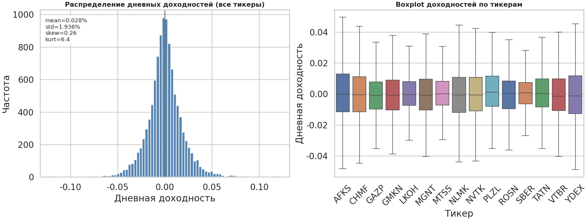
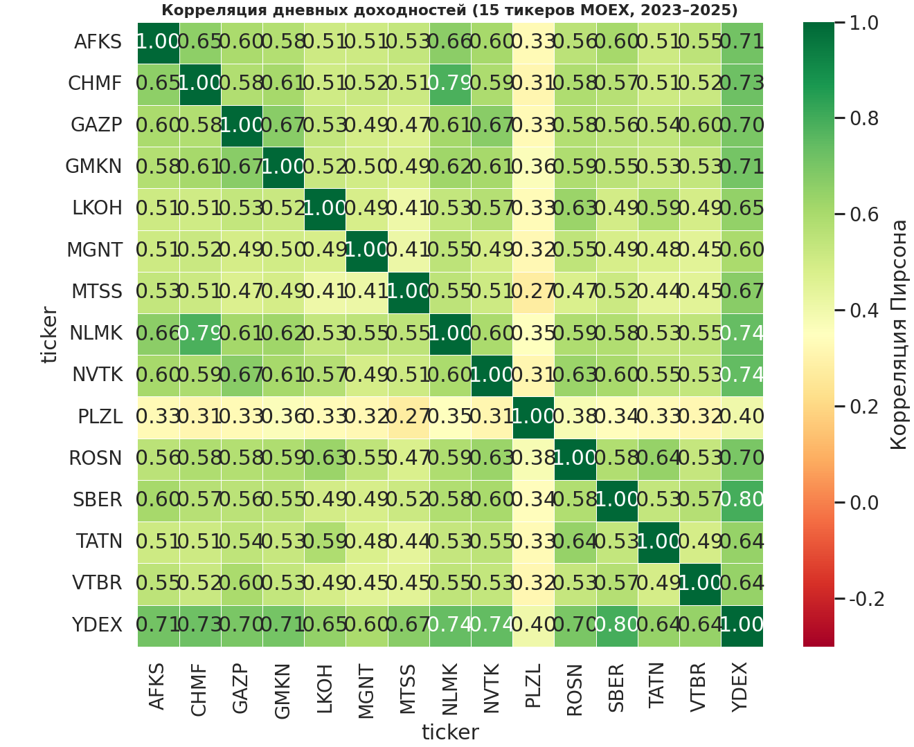
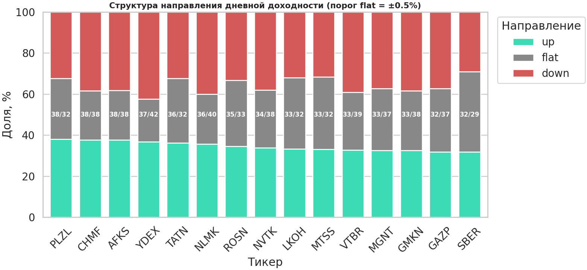
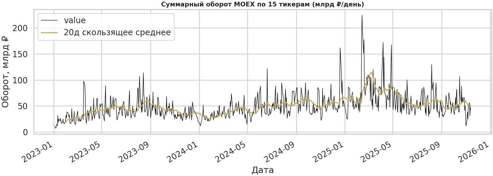
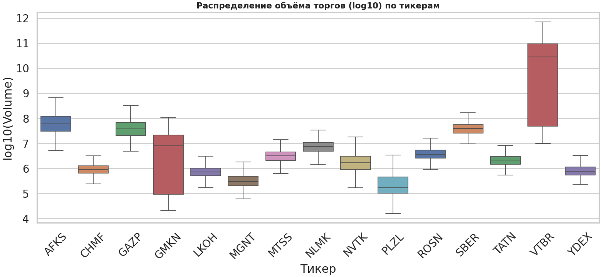
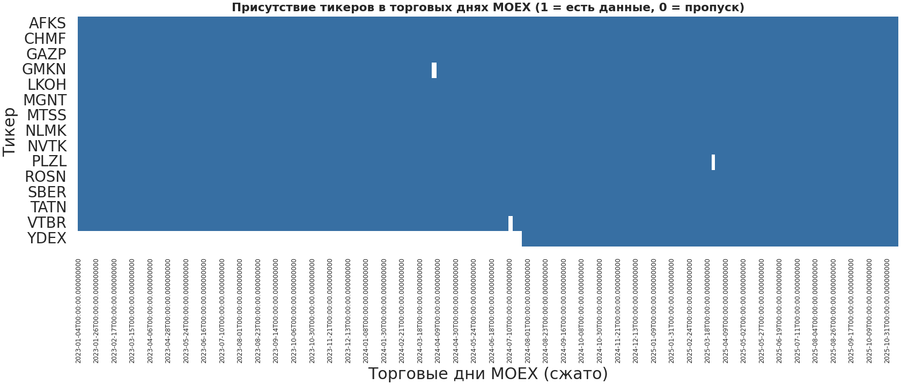
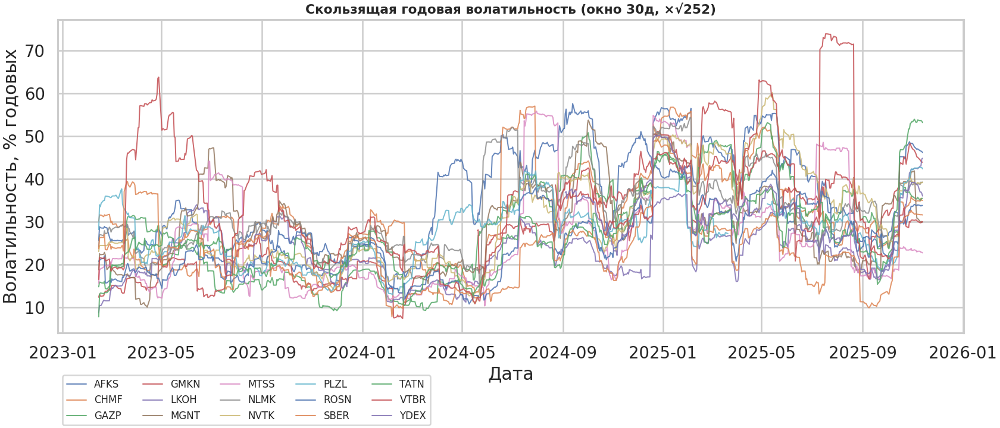
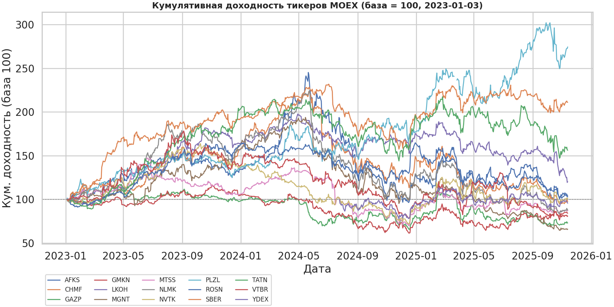

# EDA-отчёт: MOEX OHLCV по 15 тикерам (2023-01-03 … 2025-11-13)

> Источник данных: MOEX ISS API, `boards/TQBR`.
> Скрипты: `../../eda/01_fetch_moex_ohlcv.py` (загрузка), `../../eda/02_eda_analysis.py` (очистка, adjustment, визуализации).
> Данные: `../../data/raw/` (10 582 сырых строки), `../../data/processed/` (агрегаты, 10 559 строк после очистки).
> Визуализации: `figures/`.

## 1. Состав, объём и качество данных

- **Объём сырья**: 10582 строк × 17 колонок; **15 тикеров** за период **2023-01-03 … 2025-11-13** (1045 календарных дней, ~746 торговых).
- **Дубликаты** по паре (ticker, date): **0** — MOEX ISS не отдаёт дублей.
- **Пропуски в OHLCV**: {'open': 23, 'high': 23, 'low': 23, 'close': 23, 'volume': 0}.
- **Строки с нулевым объёмом / NaN close**: 23 — это переходные дни в период корпоративных действий (например, 4 дня у VTBR 2024-07-09..12 в период консолидации, 12 дней у YDEX в первые недели после редомициляции). Эти строки **удаляются перед расчётом returns** (dropna по close), чтобы не создавать fake движения цены; **после очистки остаётся 10 559 строк**.
- **Период данных**: 14 из 15 тикеров имеют полный охват 2023-01-03…2025-11-13 (~731 строка). **Исключение — YDEX: 348 строк, начиная с 2024-07-08** — это новый тикер после редомициляции Яндекса (Yandex NV → YDEX). До июля 2024 ценовая история по Yandex на MOEX отсутствует.
- **Корпоративные действия (важно для ETL)**: детектировано **3 события** с |ret| > 50% за один торговый день — это сплиты/консолидации, которые **MOEX ISS НЕ корректирует** в historical API (в отличие от Yahoo Finance, который отдаёт adjusted prices). Скачок |ret| > 50% используется **только как сигнал для проверки**: adjustment выполняется по **официальным коэффициентам эмитентов** (справочник `../../data/reference/corporate_action_factors.csv` с источниками) — все цены (open/high/low/close) ДО события умножаются на factor, чтобы весь ценовой ряд был в post-event терминах. Поправка `ratio = close_after / close_before` сознательно не используется: она обнуляет доходность в день события и стирает обычное рыночное движение этого дня. Событие без официального коэффициента не корректируется и помечается `NEEDS_MANUAL_REVIEW`. Список событий сохранён в `../../data/processed/corporate_actions.csv`.

### Детектированные корпоративные действия

| Тикер | Дата | Close, ₽ | Ret raw | Событие | Офиц. коэффициент | Ret в день события после adjustment |
|---|---|---:|---:|---|---:|---:|
| GMKN | 2024-04-08 | 152.96 | −99.0% | сплит 1:100 | 0.01 | **+1.6%** |
| PLZL | 2025-03-27 | 1867.60 | −90.2% | сплит 1:10 | 0.1 | **−1.8%** |
| VTBR | 2024-07-15 | 92.95 | +466 282% | консолидация 5000:1 | 5000 | **−6.7%** |

**Вывод для ETL**: при сборе исторических данных по MOEX необходимо на этапе preprocessing детектировать и adjust-ить корпоративные действия. Детекция — по скачку |pct_change| > 50% (сигнал для проверки), корректировка — только по официальному коэффициенту эмитента: при поправке `ratio = close_after / close_before` доходность дня события обнуляется (например, GMKN 2024-04-08 фактически вырос на +1.6%, а VTBR 2024-07-15 упал на −6.7% — это реальные рыночные движения, которые ratio-поправка стирает). Альтернатива — получать adjusted prices из внешнего источника (yfinance) для топ-N тикеров, но тогда теряется каноничность MOEX как primary source. В дизайн-доке (Этап 1) зафиксирован шаг `adjust_corporate_actions` в ETL-пайплайне.

### Сводная таблица по тикерам

| Тикер | Название | Строк | Период | Пропуски Close | Zero Volume |
|---|---|---:|---|---:|---:|
| AFKS | Система ао | 731 | 2023-01-03…2025-11-13 | 0 | 0 |
| CHMF | СевСт-ао | 731 | 2023-01-03…2025-11-13 | 0 | 0 |
| GAZP | ГАЗПРОМ ао | 731 | 2023-01-03…2025-11-13 | 0 | 0 |
| GMKN | ГМКНорНик | 731 | 2023-01-03…2025-11-13 | 4 | 4 |
| LKOH | ЛУКОЙЛ | 731 | 2023-01-03…2025-11-13 | 0 | 0 |
| MGNT | Магнит ао | 731 | 2023-01-03…2025-11-13 | 0 | 0 |
| MTSS | МТС-ао | 731 | 2023-01-03…2025-11-13 | 0 | 0 |
| NLMK | НЛМК ао | 731 | 2023-01-03…2025-11-13 | 0 | 0 |
| NVTK | Новатэк ао | 731 | 2023-01-03…2025-11-13 | 0 | 0 |
| PLZL | Полюс | 731 | 2023-01-03…2025-11-13 | 3 | 3 |
| ROSN | Роснефть | 731 | 2023-01-03…2025-11-13 | 0 | 0 |
| SBER | Сбербанк | 731 | 2023-01-03…2025-11-13 | 0 | 0 |
| TATN | Татнфт 3ао | 731 | 2023-01-03…2025-11-13 | 0 | 0 |
| VTBR | ВТБ ао | 731 | 2023-01-03…2025-11-13 | 4 | 4 |
| YDEX | ЯНДЕКС | 348 | 2024-07-08…2025-11-13 | 12 | 12 |

## 2. Распределение доходностей



### Ключевые статистики дневных доходностей (все тикеры)

| Метрика | Значение |
|---|---:|
| mean_daily_ret_pct | 0.0282 |
| std_daily_ret_pct | 1.9359 |
| annualized_vol_pct | 30.73 |
| skew | 0.261 |
| kurtosis | 6.44 |
| min_ret_pct | -22.116 |
| max_ret_pct | 13.985 |
| n_observations | 10544 |
| share_up_pct | 34.48 |
| share_down_pct | 35.78 |
| share_flat_pct | 29.73 |

**Выводы:**
- Распределение почти симметрично (skew = 0.264), но с тяжёлыми хвостами: эксцесс 6.45 против 0 у нормального — типично для фондовых рядов, значит **нужна робастная функция потерь**, например, Huber / quantile и обрезка выбросов на этапе создания фичей.
- Годовая волатильность ~30.71% — высокий уровень, характерный для MOEX (vs. ~15–18% у S&P 500). Это означает, что порог flat ±0.5% отсекает лишь ~29.76% дней; остальные 70.2% размечены как up/down.
- Соотношение up/down ~34/36% — несбалансированно, **up-класс слегка преобладает** на горизонте 2023–2025. Это создаёт дисбаланс классов, который нужно учитывать в ML-валидации.

## 3. Корреляция между тикерами



- **Средняя попарная корреляция**: 0.538, **медианная**: 0.545.
- **Максимум**: SBER ↔ YDEX = **0.795** (что интересно, кроме того, что обе компании близки к государству, причин не вижу).
- **Минимум**: MTSS ↔ PLZL = **0.274**.

**Вывод:** высокая внутрирыночная корреляция (0.54) — типично для MOEX, где ~40% индекса — Сбер + Газпром + нефтегаз. Это **ограничивает преимущество между-секционных-фичей**: модель не сможет выучить диверсифицированную альфу из ценовых движений тикеров, потому что они двигаются синхронно с рынком. Для дополнительной информативности **обязательны фундаментальные фичи (P/E, выручка, дивиденды) и новостной сигнал** (LLM-агент) — иначе boosting вырождается в market-index predictor.

## 4. Структура направления (up / flat / down)



### Доли направлений (по fwd-1d доходности, порог flat = ±0.5%)

| Тикер | Up, % | Flat, % | Down, % |
|---|---:|---:|---:|
| AFKS | 37.7 | 24.1 | 38.2 |
| CHMF | 37.7 | 24.0 | 38.4 |
| GAZP | 31.9 | 30.7 | 37.4 |
| GMKN | 32.4 | 29.2 | 38.4 |
| LKOH | 33.3 | 34.7 | 32.1 |
| MGNT | 32.6 | 30.1 | 37.3 |
| MTSS | 33.2 | 35.2 | 31.6 |
| NLMK | 35.8 | 24.1 | 40.1 |
| NVTK | 33.8 | 28.1 | 38.1 |
| PLZL | 38.1 | 29.6 | 32.3 |
| ROSN | 34.5 | 32.2 | 33.3 |
| SBER | 31.8 | 39.2 | 29.0 |
| TATN | 36.2 | 31.4 | 32.5 |
| VTBR | 32.8 | 28.2 | 39.0 |
| YDEX | 36.7 | 20.9 | 42.4 |

**Вывод:** доля flat-дней варьирует от ~21% до ~39% — это подтверждает замечание из ревью дизайн-дока: **DA-метрика на 3 классах (up/flat/down) завышает точность за счёт лёгкого flat-класса**. В дизайн-доке зафиксировано: основная метрика DA считается на up/down (без flat), DA_3class — secondary. Текущие доли подтверждают это решение.

## 5. Оборот и ликвидность



- Суммарный дневной оборот по 15 тикерам: **~49.7 млрд ₽/день** в среднем, **7.1 – 224.7 млрд ₽** в крайние дни.
- Наблюдается **всплеск волатильности оборота в 2025** — наложение геополитических новостей и выхода фундаментальной отчётности.



**Вывод:** ликвидность топ-15 тикеров **достаточна для paper-trading стратегии** — спреды минимальны, slippage в симуляции можно не закладывать (для депозита 300 000 ₽). Это снижает риск того, что PnL-критерий успеха окажется недостижимым из-за рыночных трений.

## 6. Покрытие по времени и пропуски



- Все 15 тикеров торгуются на основной площадке TQBR, торговые дни синхронизированы (в календаре MOEX одинаковые сессии).
- **YDEX — единственный тикер с урезанной историей** (с 2024-07-08). До этой даты ценового ряда нет — это означает, что для YDEX нельзя построить фичи с длинными лагами (RSI-50, MA-200) на ранних строках, и он не войдёт в обучение на ранних fold-ах walk-forward.
- Пропусков внутри торговых дней нет — ISS API отдаёт полный OHLCV на каждый торговый день.

## 7. Скользящая волатильность



- Волатильность **сильно кластеризована**: 2023 Q1 и 2025 H1 — пики. Это требует **rolling-window-валидации** (walk-forward) и retrain раз в неделю (как и зафиксировано в диздоке).
- Часть тикеров (LKOH, MGNT) системно волатильнее остальных — это даёт **структурный сигнал** для boosting-фичей: rolling volatility тикера относительно рынка (cross-sectional rank).

## 8. Кумулятивная доходность



- За период 2023-01-03…2025-11-13 **лучший тикер: SBER (~x2.11)**, худший — в зависимости от даты. Это говорит о том, что long-only стратегия по топу MOEX сама по себе была прибыльна, и **бизнес-критерий PnL > затрат достижим** при разумной торговле. Но модель должна превзойти naive top-momentum — иначе её ценность для пользователя нулевая.

## 9. Выводы EDA

1. **Достаточность данных для бейзлайна**: 15 тикеров × ~731 строка = 10 582 сырых строки, после очистки **10 559 наблюдений** — этого хватит для обучения CatBoost-бейзлайна. Важно: lagged features добавляют **признаки (колонки), а не наблюдения** — число строк от генерации лагов не растёт, наоборот, первые `max_lag = 20` строк на тикер получают NaN в лаговых фичах и отбрасываются (~10,3 тыс. пригодных строк). Рост числа наблюдений возможен только через расширение universe или удлинение периода (см. дизайн-док, п. 1.4).
2. **YDEX — отдельный риск**: 348 строк недостаточно для надёжной валидации; в MVP его можно либо исключить из watchlist, либо обучать только на данных с 2024-07.
3. **Высокая cross-ticker корреляция** ограничивает ценность фичей, основанных сугубо на ценах — нужно подключать фундаменталы (MOEX ISS) и новостной сигнал (LLM-агент, MVP блок 2).
4. **Дизбаланс классов** (up-класс слегка преобладает) — stratified walk-forward CV обязателен.
5. **Тяжёлые хвосты распределения доходностей** — использовать Huber/quantile loss, обрезать returns на ±3σ при создании фичей, либо winsorize 1%.
6. **Кластеризация волатильности** — rolling-window retrain обязателен, статичная модель не отработает смены режимов рынка.
7. **Ликвидность топ-15 высокая** — для paper trading с депозитом 300 000 ₽ рыночные трения пренебрежимы.
8. **Flat-класс варьирует 0–50%** — подтверждено решение диздока: основная DA-метрика на up/down, без flat.

## 10. Файлы EDA-артефактов

```
data/raw/ohlcv_all.csv              # сырой OHLCV, 10 582 строки
data/raw/ohlcv_<TICKER>.csv         # по тикерам
data/processed/returns_long.parquet # заготовки фичей
data/processed/summary_stats.csv    # сводная по тикерам
data/processed/up_down_flat.csv     # структура направлений
data/processed/corr_returns.csv     # корреляционная матрица
data/processed/corporate_actions.csv # КД: официальные коэффициенты, статус adjustment
reports/eda/figures/*.png           # 8 визуализаций
reports/eda/EDA_report.md           # этот отчёт
eda/01_fetch_moex_ohlcv.py          # скрипт загрузки
eda/02_eda_analysis.py              # скрипт визуализаций
data/reference/corporate_action_factors.csv  # справочник официальных коэффициентов КД
```
